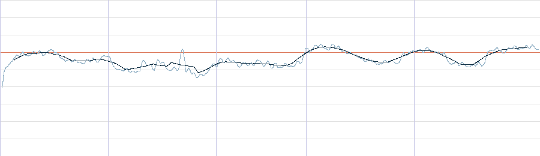
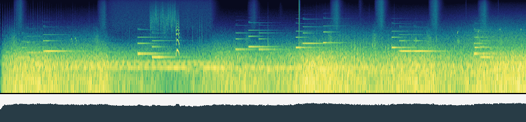

# Sound evidence (2026-11-15)

Generated by `node scripts/sound-evidence.mjs`. Every number here is a measurement of an off-line render (`tests/audio/sim.js`, a plain-JS Web Audio renderer checked against Chrome's own `OfflineAudioContext`: the audition page's `soundCheck()` gives the Chrome figures; on 15 Nov they agreed within 1.5 LU for the 14 cues compared). **Nobody has listened to any of this.** The numbers say the sounds are where the plan put them, not that they sound right.

Loudness: *peak* is sample peak (dBFS) and *tp* true peak (dBTP, 4x oversampled); *max M* the loudest 400 ms (LUFS), *int* integrated (LUFS, gated, BS.1770-4) over the render; *centroid* the spectral centroid (Hz); *len* the time above −50 dB of its own peak. Positioned cues are measured from where the audition page puts the listener (named in the cue). Spectrograms: log frequency 40 Hz (bottom) to 20 kHz (top), colour −110 to −20 dBFS; the strip under each is the envelope (−90 to 0 dBFS).

## Buses over their reference scenes

| bus | reference scene | integrated (master at 1) | target | short-term max | true peak |
|---|---|---|---|---|---|
| amb | home beach, noon, wind 7 m/s | -36.0 LUFS | -36 | -33.7 | -17.6 dBTP |
| weather | rain 4 mm/h in the open | -32.0 LUFS | -32 | -31.9 | -22.3 dBTP |
| foley | running on dry sand | -45.6 LUFS | -46 | -44.8 | -16.6 dBTP |
| voice | one meow every 5 s | -34.0 LUFS | -34 | -38.6 | -22.6 dBTP |
| world | penguin bray at 10 m every 8 s | -48.0 LUFS | -48 | -46.6 | -23.6 dBTP |
| magic | one ceremony (tideglow) | -34.0 LUFS | -34 | -31.4 | -19.9 dBTP |
| music | noon mood | -40.0 LUFS | -40 | -37.7 | -24.6 dBTP |
| **mix** | home beach, noon, walking, one meow | **-31.3 LUFS** | −30 ± 2 | -29.7 | -16.7 dBTP |

## The scripted 60 s walk

Beach → grass (a bush, a meow) → rock (a jump) → wading and a swim → the boat; noon, wind 7 m/s, music on. Hear it on the audition page, item 13.1. Integrated -31.5 LUFS, true peak -14.7 dBTP, limiter reduction at most 0.00 dB. Voices: peak 5 alive at once (cap 40); loops 11 (budget 14); node creations 32.3 per second averaged (budget 40), busiest second 77 (budget 150); stolen 0, refused 0.

| leg | seconds | integrated |
|---|---|---|
| beach (dry sand) | 0–12 | -31.4 LUFS |
| grass, a bush, a meow | 12–24 | -34.2 LUFS |
| rock, a jump | 24–34 | -33.1 LUFS |
| wading, then swimming | 34–46 | -30.4 LUFS |
| the boat | 46–60 | -30.2 LUFS |

Loudness curve: dark line short-term (3 s), light line momentary (400 ms); orange line −30 LUFS; grid every 5 LU from −60 to −15; violet lines the legs.

## Every cue

Numbered as on the audition page (`/?audition`) and in the listening checklist (sound-plan.md section 10).

### 1. The home beach at noon, standing still

| # | cue | len s | peak | tp | max M | int | centroid | meant to be | spectrogram |
|---|---|---|---|---|---|---|---|---|---|
| 1.1 | Beach at noon (scene, 30 s) | 30.30 | -17.6 | -17.6 | -29.7 | -32.8 | 202 | low slow sea that breathes, a wave rushing up every few seconds, light wind, maybe one gull; quiet enough to work to | [png](spectrograms/1.1-beach-noon.png) |
| 1.2 | One breaking wave | 4.30 | -18.3 | -18.3 | -28.6 | -30.4 | 193 | a rush that falls in pitch, then a hiss of foam | [png](spectrograms/1.2-wave.png) |

### 2. Footsteps, surface by surface (walk, then run)

| # | cue | len s | peak | tp | max M | int | centroid | meant to be | spectrogram |
|---|---|---|---|---|---|---|---|---|---|
| 2.1 | Walking on dry sand | 0.89 | -30.7 | -30.6 | -51.2 | -52.9 | 521 | a faint soft compression; you should have to listen for it | [png](spectrograms/2.1-step-dry-sand.png) |
| 2.2 | Walking on wet sand | 0.88 | -29.1 | -29.1 | -50.6 | -52.2 | 269 | a damp pad, a little darker than dry sand | [png](spectrograms/2.2-step-wet-sand.png) |
| 2.3 | Walking in grass (or a sour-fig mat) | 0.87 | -36.1 | -36.1 | -55.0 | -57.3 | 1760 | a whisper of blades | [png](spectrograms/2.3-step-grass.png) |
| 2.4 | Walking through low scrub | 0.90 | -34.5 | -34.5 | -52.7 | -54.7 | 1510 | a soft brush | [png](spectrograms/2.4-step-scrub.png) |
| 2.5 | Walking on leaf litter | 0.91 | -35.6 | -35.6 | -53.0 | -54.9 | 1134 | a soft dry settle | [png](spectrograms/2.5-step-forest.png) |
| 2.6 | Walking on rock or the stoep | 0.85 | -35.1 | -35.1 | -58.2 | -60.1 | 812 | almost nothing | [png](spectrograms/2.6-step-rock.png) |
| 2.7 | Walking on shingle | 0.86 | -36.7 | -36.7 | -56.0 | -58.1 | 1111 | a soft grit shifting | [png](spectrograms/2.7-step-pebbles.png) |
| 2.8 | Walking on timber (the keelson, the milkwood's limb) | 0.86 | -32.4 | -32.4 | -51.6 | -54.1 | 241 | a soft low pad | [png](spectrograms/2.8-step-timber.png) |
| 2.9 | Walking on the boat's deck | 0.96 | -31.0 | -31.0 | -50.3 | -53.2 | 197 | a soft low pad, a touch hollow | [png](spectrograms/2.9-step-deck.png) |
| 2.10 | Walking in the swash | 0.93 | -31.0 | -30.9 | -50.7 | -52.0 | 825 | a soft wet pad, no plinks | [png](spectrograms/2.10-step-shallows.png) |
| 2.11 | Running on dry sand | 0.65 | -21.7 | -21.7 | -40.7 | -43.1 | 578 | clearly there now, still soft; front paws only, never a machine-gun | [png](spectrograms/2.11-run-dry-sand.png) |
| 2.12 | Running through grass | 0.63 | -26.8 | -26.6 | -44.9 | -47.4 | 1846 | a quicker whisper | [png](spectrograms/2.12-run-grass.png) |
| 2.13 | Landing a jump on sand | 0.15 | -25.9 | -25.9 | -43.8 | -43.8 | 209 | a soft low settle | [png](spectrograms/2.13-land-sand.png) |
| 2.14 | Jump | 0.21 | -33.6 | -33.5 | -50.6 | -53.3 | 715 | a short whoosh of fur | [png](spectrograms/2.14-jump.png) |

### 3. Pushing through a bush, stopping, coming out

| # | cue | len s | peak | tp | max M | int | centroid | meant to be | spectrogram |
|---|---|---|---|---|---|---|---|---|---|
| 3.1 | Pushing through a bush (scene, 4 s: move 2.5 s, stop, leave) | 3.79 | -34.4 | -34.1 | -47.3 | -48.0 | 5977 | leaves rustle only while moving, stop dead when it stops, one soft spring-back on leaving | [png](spectrograms/3.1-rustle.png) |
| 3.2 | Through restio and dry grass (scene, 2.5 s) | 2.66 | -32.8 | -32.8 | -48.8 | -49.5 | 7931 | a finer, higher hiss | [png](spectrograms/3.2-rustle-restio.png) |

### 4. Into the sea and out again

| # | cue | len s | peak | tp | max M | int | centroid | meant to be | spectrogram |
|---|---|---|---|---|---|---|---|---|---|
| 4.1 | Wading belly deep | 0.23 | -22.5 | -22.5 | -43.6 | -46.1 | 211 | a slosh per stride | [png](spectrograms/4.1-wade.png) |
| 4.2 | Bounding into the sea | 0.53 | -13.4 | -13.4 | -30.0 | -36.3 | 1793 | a plunge with a low body, then drops | [png](spectrograms/4.2-splash-in.png) |
| 4.3 | Swimming (scene, 6 s) | 6.30 | -24.2 | -24.2 | -42.9 | -46.2 | 210 | soft paddle strokes with a bubble, a small breath now and then | [png](spectrograms/4.3-swim.png) |
| 4.4 | Coming out: drips | 1.33 | -35.7 | -35.7 | -48.4 | -51.4 | 1381 | drips slowing | [png](spectrograms/4.4-drips.png) |
| 4.5 | The shake (wet) | 0.96 | -28.2 | -27.9 | -43.3 | -45.7 | 2391 | a flutter of fur throwing off spray, droplets after | [png](spectrograms/4.5-shake.png) |

### 5. Meow, and what answers

| # | cue | len s | peak | tp | max M | int | centroid | meant to be | spectrogram |
|---|---|---|---|---|---|---|---|---|---|
| 5.1 | Meow | 0.67 | -23.3 | -23.3 | -27.3 | -28.9 | 1154 | a small cat, not a synthesiser: 'mi-aow' | [png](spectrograms/5.1-meow.png) |
| 5.2 | Short greeting meow (an animal close) | 0.38 | -26.4 | -26.4 | -33.5 | -34.7 | 1000 | quicker and brighter | [png](spectrograms/5.2-meow-short.png) |
| 5.3 | Chirrup | 0.29 | -30.2 | -30.2 | -37.7 | -39.2 | 755 | a questioning 'mrrp?' | [png](spectrograms/5.3-chirrup.png) |
| 5.4 | The wisp's answer | 1.25 | -31.9 | -31.9 | -39.2 | -41.8 | 1582 | three small glassy notes skipping up | [png](spectrograms/5.4-wisp.png) |
| 5.5 | A penguin's soft 'haw' back (8 m left) | 0.83 | -35.9 | -35.9 | -46.5 | -47.3 | 323 | one short soft honk | [png](spectrograms/5.5-haw.png) |
| 5.6 | The owl in the milkwood (25 m ahead) | 1.96 | -41.5 | -41.5 | -43.6 | -46.6 | 335 | a soft 'hoo, hooo', the second lower and longer | [png](spectrograms/5.6-owl.png) |
| 5.7 | The lighthouse throwing a meow back (25 m) | 0.79 | -20.3 | -20.3 | -26.1 | -28.0 | 1022 | the meow, late and dark | [png](spectrograms/5.7-tower-echo.png) |

### 6. The purr

| # | cue | len s | peak | tp | max M | int | centroid | meant to be | spectrogram |
|---|---|---|---|---|---|---|---|---|---|
| 6.1 | Purr (scene, 6 s) | 6.25 | -22.2 | -22.2 | -33.6 | -39.0 | 157 | low soft flutter, noticed after a moment, quieter than the sea; audible on laptop speakers | [png](spectrograms/6.1-purr.png) |

### 7. Rain, and shelter under the eave and the milkwood

| # | cue | len s | peak | tp | max M | int | centroid | meant to be | spectrogram |
|---|---|---|---|---|---|---|---|---|---|
| 7.1 | Rain 4 mm/h in the open (scene, 8 s) | 8.30 | -22.4 | -22.3 | -28.6 | -29.0 | 5855 | a soft full rain, lighter on sand | [png](spectrograms/7.1-rain-open.png) |
| 7.2 | Rain under the milkwood (scene, 8 s) | 8.30 | -16.2 | -16.0 | -25.0 | -25.3 | 8981 | the open rain softer, leaves louder, big drips falling | [png](spectrograms/7.2-rain-tree.png) |
| 7.3 | Rain on the iron roof, 12 m away (scene, 8 s) | 8.30 | -12.4 | -12.4 | -24.7 | -25.3 | 4982 | the roof ringing and drumming from where it is | [png](spectrograms/7.3-rain-roof.png) |
| 7.4 | Under the eave (scene, 8 s) | 8.30 | -18.8 | -18.8 | -33.8 | -37.2 | 990 | outside soft and far, the roof loud overhead, a gutter dripping: the contrast is the point | [png](spectrograms/7.4-rain-eave.png) |
| 7.5 | Thunder, 1.5 km | 11.54 | -13.2 | -13.2 | -24.5 | -27.9 | 131 | a crack then rolls; loud but not painful | [png](spectrograms/7.5-thunder-near.png) |
| 7.6 | Thunder, 8 km | 28.47 | -19.5 | -19.5 | -30.2 | -36.7 | 84 | only a low grumble | [png](spectrograms/7.6-thunder-far.png) |

### 8. The boat

| # | cue | len s | peak | tp | max M | int | centroid | meant to be | spectrogram |
|---|---|---|---|---|---|---|---|---|---|
| 8.1 | Hopping on the upturned hull | 0.54 | -17.9 | -17.9 | -33.7 | -36.0 | 151 | a hollow wooden knock | [png](spectrograms/8.1-boat-knock.png) |
| 8.2 | Keel scraping down the sand | 1.33 | -19.8 | -19.8 | -36.1 | -39.2 | 504 | a rough sandy scrape rising | [png](spectrograms/8.2-boat-scrape.png) |
| 8.3 | Afloat: the bow meets the water | 0.70 | -9.4 | -9.4 | -26.9 | -31.5 | 203 | a last scrape, a plunge, a slap | [png](spectrograms/8.3-boat-launch.png) |
| 8.4 | Stepping aboard | 0.21 | -27.7 | -27.7 | -44.2 | -44.2 | 180 | a hollow knock on the deck, a slap under it | [png](spectrograms/8.4-boat-board.png) |
| 8.5 | A wave slapping the hull (aboard) | 0.21 | -23.8 | -23.8 | -41.2 | -41.2 | 171 | a low wet knock and a lick of water | [png](spectrograms/8.5-hull-slap.png) |
| 8.6 | Timber creak in a swell | 0.45 | -35.9 | -35.9 | -49.2 | -50.9 | 1409 | a slow ragged creak, not a squeal | [png](spectrograms/8.6-boat-creak.png) |
| 8.7 | The lantern's glass and wire | 0.09 | -40.3 | -40.3 | -60.4 | -60.4 | 3253 | a tiny tick | [png](spectrograms/8.7-lantern-tick.png) |
| 8.8 | The lantern's handle squeaking | 0.19 | -41.0 | -40.9 | -45.9 | -47.2 | 2675 | a very small squeak | [png](spectrograms/8.8-bail-squeak.png) |
| 8.9 | The painter coming taut | 0.29 | -40.9 | -40.9 | -55.4 | -57.6 | 1424 | a short rope creak and a soft thud | [png](spectrograms/8.9-painter.png) |
| 8.10 | Under way, aboard (scene, 8 s, speeding up) | 8.30 | -31.8 | -31.7 | -41.2 | -46.5 | 1138 | water chuckling at the bow, a wake hiss that follows the speed; a creak as it rolls | [png](spectrograms/8.10-boat-under-way.png) |

### 9. The wreck's boiler

| # | cue | len s | peak | tp | max M | int | centroid | meant to be | spectrogram |
|---|---|---|---|---|---|---|---|---|---|
| 9.1 | Walking inside the boiler | 1.38 | -34.7 | -34.7 | -49.2 | -51.2 | 301 | soft pads that the iron answers with a faint ring | [png](spectrograms/9.1-step-metal.png) |
| 9.2 | Meow inside the boiler | 3.75 | -9.0 | -9.0 | -17.6 | -21.4 | 405 | the meow comes back as one deep bell note that hangs for seconds | [png](spectrograms/9.2-boiler-meow.png) |
| 9.3 | The boiler's hollow breath (10 m) | 3.18 | -35.0 | -35.0 | -43.5 | -46.8 | 81 | wind across the mouth, barely there | [png](spectrograms/9.3-boiler-hum.png) |

### 10. Waking a gift

| # | cue | len s | peak | tp | max M | int | centroid | meant to be | spectrogram |
|---|---|---|---|---|---|---|---|---|---|
| 10.1 | Waking: fireflies (12 m ahead) | 7.49 | -38.9 | -38.9 | -46.6 | -53.4 | 1958 | hollow knock, leaves breathing out, a dozen tiny glass ticks | [png](spectrograms/10.1-waking-fireflies.png) |
| 10.2 | Waking: tideglow (12 m ahead) | 8.23 | -34.7 | -34.7 | -47.5 | -52.7 | 263 | struck iron, a fizz running away, a low thump into the water, bright ticks from the swash | [png](spectrograms/10.2-waking-tideglow.png) |
| 10.3 | Waking: lamp (12 m ahead) | 9.58 | -30.8 | -30.8 | -37.2 | -45.3 | 104 | a match, two puffs, a warm low swell, slow clockwork, small 'pt's along the necklace | [png](spectrograms/10.3-waking-lamp.png) |
| 10.4 | Waking: stars (12 m ahead) | 4.92 | -38.9 | -38.9 | -43.0 | -46.9 | 1810 | a high glass harmonic swelling, wind down the hill, a soft meteor hiss | [png](spectrograms/10.4-waking-stars.png) |
| 10.5 | Waking: seafolk (12 m ahead) | 7.02 | -34.7 | -34.7 | -44.1 | -49.6 | 249 | a deep bloop and bubbles, water running out, a seal answers far off | [png](spectrograms/10.5-waking-seafolk.png) |
| 10.6 | Waking: boat (12 m ahead) | 8.80 | -27.7 | -27.7 | -39.7 | -45.7 | 593 | lantern glass, a match, a creak, keel on sand, a slap, two little squeaks | [png](spectrograms/10.6-waking-boat.png) |
| 10.7 | Ceremony phrase: tideglow (music off) | 10.30 | -23.0 | -23.0 | -30.3 | -33.5 | 627 | one slow swelling phrase on D; one event, not three | [png](spectrograms/10.7-ceremony-tideglow.png) |
| 10.8 | Ceremony phrase: fireflies (music off) | 8.30 | -23.1 | -23.1 | -30.7 | -33.5 | 1162 | small and glassy, with an afterglow | [png](spectrograms/10.8-ceremony-fireflies.png) |

### 11. The animals

| # | cue | len s | peak | tp | max M | int | centroid | meant to be | spectrogram |
|---|---|---|---|---|---|---|---|---|---|
| 11.1 | The penguin colony from the spawn beach (30 m right) | 1.91 | -43.5 | -43.5 | -49.4 | -52.6 | 325 | a soft far-off honk or two; faint under the sea | [png](spectrograms/11.1-penguin-bray.png) |
| 11.2 | A penguin calling close by (8 m right) | 1.76 | -29.3 | -29.3 | -35.2 | -38.4 | 324 | the same soft honk, nearer: still not a donkey | [png](spectrograms/11.2-penguin-near.png) |
| 11.3 | A penguin startled by the cat (5 m) | 0.82 | -32.8 | -32.8 | -43.4 | -44.1 | 323 | one short soft haw | [png](spectrograms/11.3-penguin-startled.png) |
| 11.4 | A seal across the rocks (40 m left) | 1.19 | -38.5 | -38.5 | -49.0 | -50.1 | 255 | one or two soft gruff barks | [png](spectrograms/11.4-seal-bark.png) |
| 11.5 | A seal lifting its head (8 m) | 0.69 | -25.6 | -25.6 | -44.3 | -46.1 | 524 | a soft snort | [png](spectrograms/11.5-seal-snort.png) |
| 11.6 | The whale blowing far out (110 m) | 2.67 | -28.9 | -28.9 | -41.2 | -45.3 | 201 | a deep wet exhale, far off | [png](spectrograms/11.6-whale-blow.png) |
| 11.7 | The whale's tail on the water (110 m) | 1.24 | -29.0 | -29.0 | -43.3 | -46.1 | 156 | a soft heavy wash, far off | [png](spectrograms/11.7-whale-slap.png) |
| 11.8 | The tortoise withdrawing (1 m) | 0.52 | -30.9 | -30.8 | -46.7 | -48.5 | 2352 | a short soft hiss; you must be close | [png](spectrograms/11.8-tortoise-hiss.png) |
| 11.9 | Oystercatchers flushed (10 m) | 1.10 | -32.6 | -32.4 | -44.2 | -45.4 | 3456 | a few piping notes, then soft wings | [png](spectrograms/11.9-oystercatchers.png) |
| 11.10 | A kelp gull over the water (45 m) | 1.04 | -45.4 | -45.4 | -48.9 | -50.4 | 1360 | a soft falling call, far off | [png](spectrograms/11.10-gull.png) |
| 11.11 | Crickets at night, the cat walking through (scene, 10 s) | 10.30 | -34.9 | -34.9 | -45.5 | -47.8 | 206 | chirps round you; the near ones stop as you walk past and come back after | [png](spectrograms/11.11-crickets.png) |

### 12. The story's moments

| # | cue | len s | peak | tp | max M | int | centroid | meant to be | spectrogram |
|---|---|---|---|---|---|---|---|---|---|
| 12.1 | A star falling | 1.50 | -59.9 | -59.7 | -66.9 | -68.1 | 4285 | a thin airy hiss falling, quiet until the end | [png](spectrograms/12.1-star-fall.png) |
| 12.2 | It lands in the sand (9 m) | 0.98 | -35.7 | -35.7 | -53.1 | -59.3 | 172 | a low soft thump, grains ticking, one glassy tick | [png](spectrograms/12.2-star-land.png) |
| 12.3 | Home phrase, 1 light lit | 4.75 | -28.2 | -28.2 | -31.2 | -35.6 | 644 | the first 1 note, the last held and left hanging | [png](spectrograms/12.3-home-1.png) |
| 12.4 | Home phrase, 3 lights lit | 5.65 | -24.1 | -24.1 | -30.0 | -34.6 | 773 | the first 3 notes, the last held and left hanging | [png](spectrograms/12.4-home-3.png) |
| 12.5 | Home phrase, 6 lights lit | 7.00 | -21.3 | -21.3 | -27.2 | -32.0 | 1014 | the six notes rising and resolving, the octave below under the last | [png](spectrograms/12.5-home-6.png) |
| 12.6 | The wisp's note (n = 3) | 1.39 | -35.2 | -35.2 | -42.9 | -47.2 | 753 | one bell-like pluck with a shimmer | [png](spectrograms/12.6-wisp-note.png) |
| 12.7 | A wick catching (the lamp's, larger) | 0.93 | -45.5 | -45.5 | -59.1 | -64.6 | 1175 | a soft 'fff', two gutters, settling | [png](spectrograms/12.7-wick-catch.png) |
| 12.8 | Lantern glass ticking as it warms | 1.76 | -43.8 | -43.7 | -61.4 | -61.5 | 3523 | two or three irregular ticks | [png](spectrograms/12.8-glass-tick.png) |
| 12.9 | The lighthouse beam holding the cat | 5.28 | -29.3 | -29.3 | -33.8 | -34.5 | 115 | a low warm swell, no attack | [png](spectrograms/12.9-beam-hold.png) |
| 12.10 | The lighthouse clockwork (6 m) | 3.58 | -35.0 | -35.0 | -56.2 | -56.2 | 715 | a slow heavy escapement, one tick a second | [png](spectrograms/12.10-clockwork.png) |
| 12.11 | The first lit swash | 1.83 | -54.5 | -54.4 | -60.1 | -62.3 | 4483 | the swash with a faint glassy shimmer | [png](spectrograms/12.11-tide-light.png) |
| 12.12 | The rock pool: drip and suck | 1.03 | -33.3 | -33.2 | -55.1 | -61.1 | 1062 | a drip, then water sucking in rock | [png](spectrograms/12.12-pool-drip.png) |
| 12.13 | A loose shutter in wind (10 m) | 1.03 | -27.0 | -27.0 | -48.4 | -50.5 | 201 | a wooden knock or two, irregular | [png](spectrograms/12.13-shutter.png) |
| 12.14 | The whale beside the boat (15 m) | 3.33 | -11.1 | -11.1 | -27.6 | -35.2 | 322 | a deep hollow exhale with wet in it, then a long inhale | [png](spectrograms/12.14-whale-near.png) |
| 12.15 | The ending's arrival | 3.57 | -35.6 | -35.6 | -37.4 | -42.3 | 1970 | one soft high bell and its octave below | [png](spectrograms/12.15-ending-arrive.png) |

### 13. All together: a 60 s walk

| # | cue | len s | peak | tp | max M | int | centroid | meant to be | spectrogram |
|---|---|---|---|---|---|---|---|---|---|
| 13.1 | Beach → grass (a bush, a meow) → rock (a jump) → wading and a swim → the boat (scene, 60 s) | 60.30 | -14.7 | -14.7 | -27.6 | -31.5 | 270 | the whole mix: quiet, the sea underneath, each surface answering the paws; nothing you want to turn off | [png](spectrograms/13.1-walk.png) |
