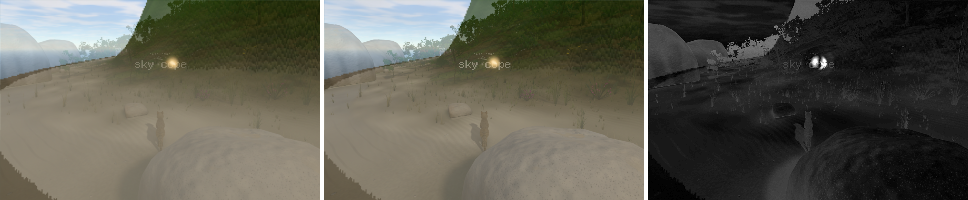
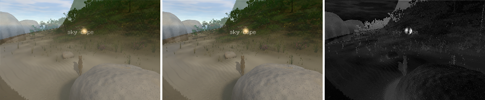
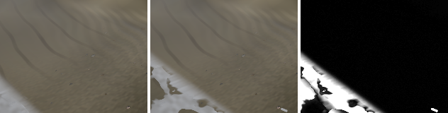

# Stability, 2026-11-15T06:54 (1280x800 @1, seed 1847)

| session | captured | seconds | blank | lum | sharp | popStill | popMoving | worstPopPixels | flashStill | flashMoving | vanishStill | vanishMoving | flicker | leafLight | leafSteps | hitches | worstHitchMs | resizes | unsynced | quality | reveal | shadowSwaps | placeLod | animalLod | errors |
| --- | --- | --- | --- | --- | --- | --- | --- | --- | --- | --- | --- | --- | --- | --- | --- | --- | --- | --- | --- | --- | --- | --- | --- | --- | --- |
| leaves | 334 | 51 | 0 | 18 | 16 | 16 | 79 | 2304 | 26 | 67 | 3 | 59 | 0.363 | 0.204 | 8 | 3 | 185 | 0 | 0 | 0 | 1 | 4 | 7 | 4 | 0 |

Columns: frames captured (screencast) and seconds rendered; blank frames; persistent luminance
and sharpness steps with the camera still; pops (abrupt local changes that stay) with the camera
still and moving, the worst still one in pixels; one-frame flashes; hitches (gaps of 100 ms+
between rendered frames) and the worst; canvas resizes and those outside the frame boundary;
budget level changes; reveal steps; shadow-map swaps; landmark and animal LOD switches.

## leaves

- 515 ms [navigate] **lum** step -0.85 — no event
- 581 ms [navigate] **lum** step -1.27 — no event
- 581 ms [navigate] **sharp** step 4.3 — no event
- 631 ms [navigate] **lum** step -1.35 — no event
- 631 ms [navigate] **sharp** step 5.9 — no event
- 665 ms [navigate] **lum** step -1.14 — no event
- 665 ms [navigate] **sharp** step 4.1 — no event
- 715 ms [navigate] **lum** step -2.08 — no event
- 715 ms [navigate] **sharp** step 6.6 — no event
- 765 ms [navigate] **lum** step -2.58 — no event
- 765 ms [navigate] **sharp** step 6 — no event
- 831 ms [navigate] **lum** step -4.29 — no event
- 831 ms [navigate] **sharp** step 25 — no event
- 915 ms [navigate] **lum** step -6.12  — no event
- 915 ms [navigate] **sharp** step 35.4 — no event
- 931 ms [navigate] **lum** step -1.23 — no event
- 931 ms [navigate] **sharp** step 7.2 — no event
- 981 ms [navigate] **lum** step -3.63 — no event
- 981 ms [navigate] **sharp** step 30.2 — no event
- 1065 ms [navigate] **lum** step -5.43 — no event
- 1065 ms [navigate] **sharp** step 77.3  — no event
- 1081 ms [navigate] **lum** step -0.98 — no event
- 1081 ms [navigate] **sharp** step 9.6 — no event
- 1165 ms [navigate] **lum** step -4.3 — no event
- 1165 ms [navigate] **sharp** step 19.8 — no event
- 1215 ms [navigate] **lum** step -2.17 — no event
- 1215 ms [navigate] **sharp** step 5.8 — no event
- 1315 ms [navigate] **lum** step -3.59 — no event
- 1315 ms [navigate] **sharp** step 8.7 — no event
- 1398 ms [navigate] **lum** step -1.84 — no event
- 1398 ms [navigate] **sharp** step 4.2 — no event
- 1498 ms [navigate] **lum** step -2.18 — no event
- 1498 ms [navigate] **sharp** step 5.4 — no event
- 1581 ms [navigate] **lum** step -1.1 — no event
- 2065 ms [navigate] **pop** 2304 px — no event
- 2065 ms [navigate] **flash** 1792 px — no event
- 2115 ms [navigate] **pop** 768 px — no event
- 2115 ms [navigate] **flash** 8704 px  — no event
- 2165 ms [navigate] **pop** 2048 px — no event
- 2165 ms [navigate] **flash** 3072 px — no event
- (79 pops while the camera moved; in stability.json)
- 603 ms [navigate] **hitch** 185 ms — no event
- 4737 ms [navigate] **hitch** 109 ms — prewarm-done slices=35 compiled=71 programs=93; prewarm-end; magic-pipelines
- 6468 ms [navigate] **hitch** 120 ms — shadow-request jump=true; lod-pack chunks=379; animal-lod herd=herd coarse=true distance=64; shadow-swap slice=1 count=1
