# Stability, 2026-11-15T06:53 (1280x800 @1, seed 1847)

| session | captured | seconds | blank | lum | sharp | popStill | popMoving | worstPopPixels | flashStill | flashMoving | vanishStill | vanishMoving | flicker | leafLight | leafSteps | hitches | worstHitchMs | resizes | unsynced | quality | reveal | shadowSwaps | placeLod | animalLod | errors |
| --- | --- | --- | --- | --- | --- | --- | --- | --- | --- | --- | --- | --- | --- | --- | --- | --- | --- | --- | --- | --- | --- | --- | --- | --- | --- |
| still | 622 | 61.7 | 0 | 13 | 15 | 12 | 148 | 9216 | 32 | 133 | 2 | 54 | 0.221 | 0.192 | 17 | 2 | 226 | 1 | 0 | 2 | 1 | 3 | 6 | 5 | 0 |
| walk | 648 | 48.3 | 0 | 8 | 5 | 25 | 135 | 22016 | 19 | 77 | 1 | 155 | 0.246 | 0.298 | 10 | 3 | 248 | 1 | 0 | 2 | 1 | 4 | 6 | 3 | 0 |
| orbit | 205 | 33.1 | 0 | 9 | 9 | 4 | 53 | 43264 | 2 | 51 | 2 | 76 | 0.325 | 0.547 | 10 | 2 | 190 | 1 | 0 | 2 | 1 | 30 | 6 | 3 | 0 |
| time | 195 | 47.9 | 0 | 4 | 2 | 9 | 19 | 880384 | 19 | 16 | 4 | 16 | 1.126 | 0.31 | 7 | 3 | 201 | 1 | 0 | 2 | 1 | 41 | 6 | 3 | 0 |
| gift | 167 | 40.1 | 0 | 2 | 0 | 11 | 41 | 12544 | 27 | 26 | 2 | 17 | 0.81 | 0.846 | 6 | 3 | 325 | 3 | 0 | 4 | 1 | 2 | 6 | 3 | 0 |
| throttle | 708 | 72.7 | 0 | 2 | 0 | 21 | 187 | 26368 | 25 | 178 | 2 | 72 | 0.602 | 0.494 | 31 | 3 | 341 | 3 | 0 | 6 | 1 | 3 | 6 | 3 | 0 |
| routes | 805 | 67.5 | 0 | 5 | 3 | 27 | 332 | 27136 | 11 | 223 | 4 | 251 | 0.264 | 0.15 | 6 | 2 | 411 | 3 | 0 | 7 | 1 | 12 | 14 | 5 | 0 |

Columns: frames captured (screencast) and seconds rendered; blank frames; persistent luminance
and sharpness steps with the camera still; pops (abrupt local changes that stay) with the camera
still and moving, the worst still one in pixels; one-frame flashes; hitches (gaps of 100 ms+
between rendered frames) and the worst; canvas resizes and those outside the frame boundary;
budget level changes; reveal steps; shadow-map swaps; landmark and animal LOD switches.

## still

- 575 ms [revealed] **sharp** step 6.5 — no event
- 641 ms [revealed] **lum** step -1.06 — no event
- 641 ms [revealed] **sharp** step 10.1 — no event
- 675 ms [revealed] **sharp** step 5.6 — no event
- 741 ms [revealed] **lum** step -1.77 — no event
- 741 ms [revealed] **sharp** step 10.3 — no event
- 741 ms [revealed] **pop** 768 px — no event
- 775 ms [revealed] **lum** step -1.11 — no event
- 775 ms [revealed] **sharp** step 4.6 — no event
- 858 ms [revealed] **lum** step -3.43 — no event
- 858 ms [revealed] **sharp** step 9 — no event
- 858 ms [revealed] **pop** 768 px — no event
- 958 ms [revealed] **lum** step -4.92 — no event
- 958 ms [revealed] **sharp** step 93.7 — no event
- 958 ms [revealed] **vanish** 768 px 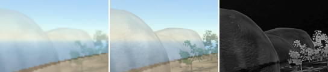 — no event
- 991 ms [revealed] **lum** step -1.63 — no event
- 991 ms [revealed] **sharp** step 25 — no event
- 1108 ms [revealed] **lum** step -5.05 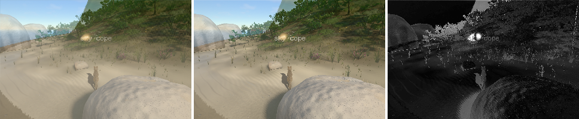 — no event
- 1108 ms [revealed] **sharp** step 144  — no event
- 1108 ms [revealed] **vanish** 1024 px — no event
- 1125 ms [revealed] **sharp** step 8.3 — no event
- 1241 ms [revealed] **lum** step -3.67 — no event
- 1241 ms [revealed] **sharp** step 21 — no event
- 1275 ms [revealed] **lum** step -0.88 — no event
- 1341 ms [revealed] **lum** step -1.49 — no event
- 1341 ms [revealed] **sharp** step 5.8 — no event
- 1408 ms [revealed] **lum** step -1.3 — no event
- 1408 ms [revealed] **sharp** step 4.4 — no event
- 1475 ms [revealed] **lum** step -1.04 — no event
- 1475 ms [revealed] **sharp** step 3.6 — no event
- 1608 ms [revealed] **lum** step -1.61 — no event
- 1608 ms [revealed] **sharp** step 5.7 — no event
- 2025 ms [revealed] **pop** 768 px — no event
- 2141 ms [revealed] **pop** 2560 px — no event
- 2141 ms [revealed] **flash** 1280 px — no event
- 2191 ms [revealed] **pop** 1280 px — no event
- 2191 ms [revealed] **flash** 4864 px — no event
- 2241 ms [revealed] **pop** 1280 px — no event
- 2241 ms [revealed] **flash** 4608 px — no event
- 2308 ms [revealed] **pop** 1280 px — no event
- (148 pops while the camera moved; in stability.json)
- 646 ms [revealed] **hitch** 226 ms — no event
- 4964 ms [revealed] **hitch** 130 ms — prewarm-done slices=35 compiled=71 programs=93; prewarm-end; magic-pipelines

## walk

- 873 ms [navigate] **lum** step -11.18 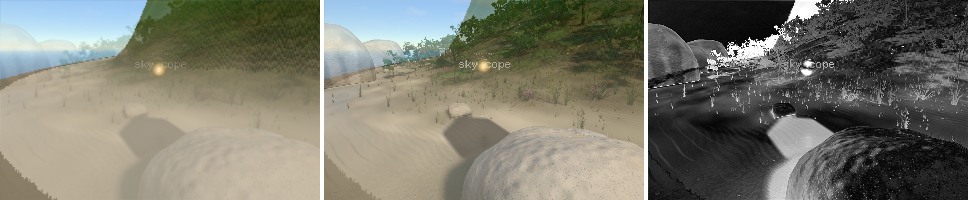 — animal-lod herd=herd coarse=true distance=29; animal-lod herd=herd coarse=true distance=61
- 873 ms [navigate] **sharp** step 276  — animal-lod herd=herd coarse=true distance=29; animal-lod herd=herd coarse=true distance=61
- 873 ms [navigate] **vanish** 1024 px 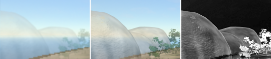 — animal-lod herd=herd coarse=true distance=29; animal-lod herd=herd coarse=true distance=61
- 923 ms [navigate] **lum** step -2.27 — animal-lod herd=herd coarse=true distance=61
- 923 ms [navigate] **sharp** step 46.6 — animal-lod herd=herd coarse=true distance=61
- 1090 ms [navigate] **lum** step -5.85 — animal-lod herd=herd coarse=true distance=61; environment
- 1090 ms [navigate] **sharp** step 46.6 — animal-lod herd=herd coarse=true distance=61; environment
- 1373 ms [navigate] **lum** step -3.16 — environment
- 1373 ms [navigate] **sharp** step 22.3 — environment
- 1373 ms [navigate] **pop** 6912 px — environment
- 1757 ms [navigate] **lum** step -2.14 — no event
- 1757 ms [navigate] **sharp** step 7.8 — no event
- 1757 ms [navigate] **flash** 1280 px — no event
- 2023 ms [navigate] **flash** 2048 px — no event
- 2273 ms [navigate] **pop** 4864 px — no event
- 2273 ms [navigate] **flash** 6912 px — no event
- 2307 ms [navigate] **pop** 16896 px — no event
- 2657 ms [navigate] **lum** step -1.8 — no event
- 2657 ms [navigate] **pop** 22016 px 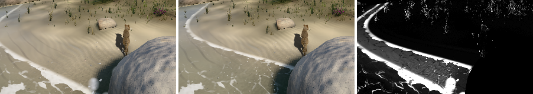 — no event
- 2657 ms [navigate] **flash** 1024 px — no event
- 2723 ms [navigate] **pop** 2816 px — no event
- 2823 ms [navigate] **pop** 1280 px — no event
- 8890 ms [navigate] **flash** 768 px — no event
- 9456 ms [navigate] **flash** 768 px — no event
- 9523 ms [navigate] **flash** 1024 px — no event
- 9623 ms [navigate] **flash** 1536 px — no event
- 9790 ms [navigate] **flash** 768 px — no event
- 9856 ms [navigate] **flash** 768 px — no event
- 9956 ms [navigate] **flash** 1024 px — no event
- 10540 ms [walk] **flash** (moving) 2048 px — lod-pack 2 chunks
- 10656 ms [walk] **flash** (moving) 1536 px — lod-pack 3 chunks
- 10823 ms [walk] **flash** (moving) 8448 px — lod-pack 3 chunks
- 10940 ms [walk] **flash** (moving) 2816 px — lod-pack 1 chunks
- 11023 ms [walk] **flash** (moving) 5888 px — lod-pack 1 chunks
- 11123 ms [walk] **flash** (moving) 8448 px — lod-pack 7 chunks
- 11206 ms [walk] **flash** (moving) 7424 px — lod-pack 8 chunks
- 11290 ms [walk] **flash** (moving) 9728 px — lod-pack 16 chunks
- 11373 ms [walk] **flash** (moving) 8960 px — lod-pack 14 chunks
- 11473 ms [walk] **flash** (moving) 5120 px — lod-pack 24 chunks
- 11556 ms [walk] **flash** (moving) 4352 px — lod-pack 24 chunks
- (135 pops while the camera moved; in stability.json)
- 462 ms [navigate] **hitch** 236 ms — no event
- 1061 ms [navigate] **hitch** 161 ms — no event
- 10010 ms [walk] **hitch** 248 ms — no event

## orbit

- 540 ms [navigate] **lum** step -1.63 — no event
- 540 ms [navigate] **sharp** step 11 — no event
- 607 ms [navigate] **lum** step -2.25 — no event
- 607 ms [navigate] **sharp** step 8.9 — no event
- 790 ms [navigate] **lum** step -9.02 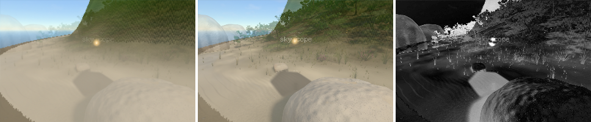 — animal-lod herd=herd coarse=true distance=29
- 790 ms [navigate] **sharp** step 110.4 — animal-lod herd=herd coarse=true distance=29
- 790 ms [navigate] **vanish** 3328 px 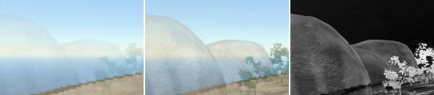 — animal-lod herd=herd coarse=true distance=29
- 823 ms [navigate] **lum** step -1.76 — animal-lod herd=herd coarse=true distance=29
- 823 ms [navigate] **sharp** step 24.7 — animal-lod herd=herd coarse=true distance=29
- 957 ms [navigate] **lum** step -6.17 — animal-lod herd=herd coarse=true distance=61
- 957 ms [navigate] **sharp** step 161.6 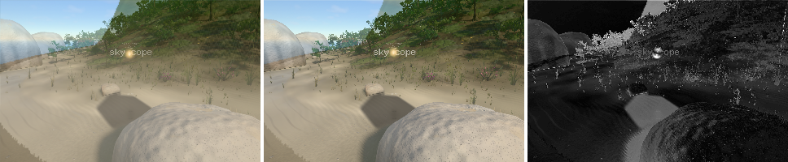 — animal-lod herd=herd coarse=true distance=61
- 957 ms [navigate] **vanish** 2048 px — animal-lod herd=herd coarse=true distance=61
- 1073 ms [navigate] **lum** step -3.99 — animal-lod herd=herd coarse=true distance=61
- 1073 ms [navigate] **sharp** step 20.9 — animal-lod herd=herd coarse=true distance=61
- 1257 ms [navigate] **lum** step -1.91 — no event
- 1257 ms [navigate] **sharp** step 17.5 — no event
- 1257 ms [navigate] **pop** 1024 px — no event
- 1440 ms [navigate] **lum** step -2.14 — no event
- 1440 ms [navigate] **sharp** step 7.3 — no event
- 1807 ms [navigate] **lum** step -2.04 — no event
- 1807 ms [navigate] **sharp** step 7.8 — no event
- 2473 ms [navigate] **pop** 43264 px 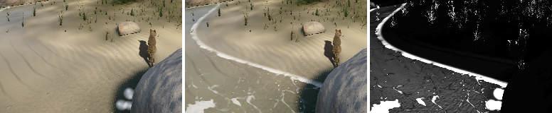 — environment
- 2473 ms [navigate] **flash** 2048 px — environment
- 2823 ms [navigate] **pop** 3328 px — no event
- 2823 ms [navigate] **flash** 1536 px — no event
- 2990 ms [navigate] **pop** 1024 px — no event
- 9206 ms [orbit] **flash** (moving) 2816 px — lod-pack 2 chunks
- 9206 ms [orbit] **vanish** (moving) 3840 px — lod-pack 2 chunks
- 9240 ms [orbit] **flash** (moving) 1280 px — environment; lod-pack 23 chunks
- 9240 ms [orbit] **vanish** (moving) 1280 px — environment; lod-pack 23 chunks
- 9340 ms [orbit] **flash** (moving) 7168 px — environment; lod-pack 135 chunks
- 9340 ms [orbit] **vanish** (moving) 768 px — environment; lod-pack 135 chunks
- 9506 ms [orbit] **flash** (moving) 9728 px — environment; place-lod place=31c87b from=1 to=0 x=-4.456042089753154 z=38.35820823377907; shadow-request jump=false; shadow-slice slice=1 count=4; shadow-slice slice=2 count=4; shadow-slice slice=3 count=4; lod-pack 254 chunks
- 9506 ms [orbit] **vanish** (moving) 7680 px — environment; place-lod place=31c87b from=1 to=0 x=-4.456042089753154 z=38.35820823377907; shadow-request jump=false; shadow-slice slice=1 count=4; shadow-slice slice=2 count=4; shadow-slice slice=3 count=4; lod-pack 254 chunks
- 9673 ms [orbit] **flash** (moving) 3584 px — place-lod place=31c87b from=1 to=0 x=-4.456042089753154 z=38.35820823377907; shadow-request jump=false; shadow-slice slice=1 count=4; shadow-slice slice=2 count=4; shadow-slice slice=3 count=4; shadow-swap slice=4 count=4; lod-pack 277 chunks
- 9673 ms [orbit] **vanish** (moving) 3584 px — place-lod place=31c87b from=1 to=0 x=-4.456042089753154 z=38.35820823377907; shadow-request jump=false; shadow-slice slice=1 count=4; shadow-slice slice=2 count=4; shadow-slice slice=3 count=4; shadow-swap slice=4 count=4; lod-pack 277 chunks
- 9740 ms [orbit] **flash** (moving) 1024 px — shadow-swap slice=4 count=4; lod-pack 227 chunks
- 9740 ms [orbit] **vanish** (moving) 1536 px — shadow-swap slice=4 count=4; lod-pack 227 chunks
- 9940 ms [orbit] **flash** (moving) 1792 px — shadow-request jump=false; shadow-slice slice=1 count=4; shadow-slice slice=2 count=4; lod-pack 362 chunks
- 9940 ms [orbit] **vanish** (moving) 1024 px — shadow-request jump=false; shadow-slice slice=1 count=4; shadow-slice slice=2 count=4; lod-pack 362 chunks
- (53 pops while the camera moved; in stability.json)
- 478 ms [navigate] **hitch** 190 ms — no event
- 4727 ms [navigate] **hitch** 105 ms — prewarm-done slices=35 compiled=71 programs=90; prewarm-end; magic-pipelines

## time

- 878 ms [navigate] **flash** (moving) 11264 px — first-frame; place-lod place=c90394 from=0 to=1 x=125.16450933054168 z=58.58204935842191; place-lod place=892af9 from=0 to=1 x=62 z=86; place-lod place=b32603 from=0 to=1 x=-4.456042089753154 z=38.35820823377907; place-lod place=0c02ea from=0 to=1 x=76.69948028861975 z=40.58069007002524; place-lod place=d54aaf from=0 to=2 x=63.934342677373984 z=126.81560463466371; veil-ready; reveal ms=1400; animal-lod herd=herd coarse=true distance=29; environment
- 878 ms [navigate] **vanish** (moving) 4864 px 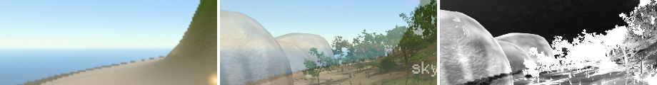 — first-frame; place-lod place=c90394 from=0 to=1 x=125.16450933054168 z=58.58204935842191; place-lod place=892af9 from=0 to=1 x=62 z=86; place-lod place=b32603 from=0 to=1 x=-4.456042089753154 z=38.35820823377907; place-lod place=0c02ea from=0 to=1 x=76.69948028861975 z=40.58069007002524; place-lod place=d54aaf from=0 to=2 x=63.934342677373984 z=126.81560463466371; veil-ready; reveal ms=1400; animal-lod herd=herd coarse=true distance=29; environment
- 2511 ms [navigate] **pop** 2048 px — no event
- 2495 ms [navigate] **pop** 2560 px — no event
- 3095 ms [navigate] **lum** step -0.87 — no event
- 3095 ms [navigate] **flash** 768 px — no event
- 3378 ms [navigate] **pop** 1536 px — prewarm-start
- 4478 ms [navigate] **pop** 768 px — no event
- 8478 ms [navigate] **flash** 768 px — no event
- 8911 ms [navigate] **flash** 1536 px — no event
- 8911 ms [navigate] **vanish** 768 px — no event
- 9311 ms [navigate] **flash** 2304 px — no event
- 9544 ms [navigate] **flash** 2304 px — no event
- 9811 ms [navigate] **flash** 2560 px — no event
- 10011 ms [navigate] **flash** 2048 px — no event
- 10344 ms [navigate] **flash** 2048 px — no event
- 10944 ms [navigate] **flash** 3584 px — no event
- 11211 ms [navigate] **flash** 1024 px — no event
- 12244 ms [time 1145] **vanish** 768 px — time minutes=1145
- 12294 ms [time 1145] **lum** step -34.43 — time minutes=1145; shadow-request jump=true; environment; shadow-swap slice=1 count=1
- 12294 ms [time 1145] **sharp** step -42.2 — time minutes=1145; shadow-request jump=true; environment; shadow-swap slice=1 count=1
- 12294 ms [time 1145] **pop** 880384 px 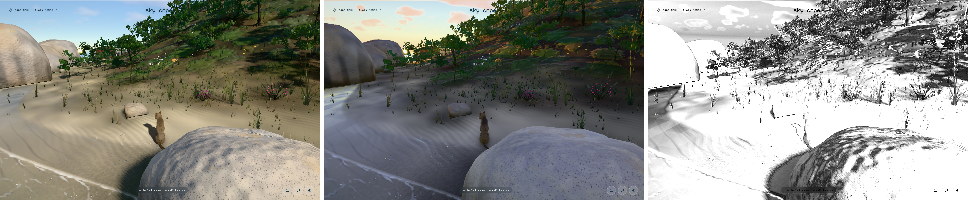 — time minutes=1145; shadow-request jump=true; environment; shadow-swap slice=1 count=1
- 12294 ms [time 1145] **vanish** 3072 px — time minutes=1145; shadow-request jump=true; environment; shadow-swap slice=1 count=1
- 16344 ms [time 1145] **flash** 768 px — no event
- 16544 ms [time 1145] **flash** 3328 px — no event
- 16744 ms [time 1145] **pop** 1024 px — quality from=0 to=1 cost=21
- 16744 ms [time 1145] **flash** 5632 px 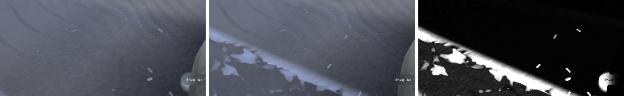 — quality from=0 to=1 cost=21
- 17077 ms [time 1145] **pop** 768 px — quality from=0 to=1 cost=21
- 17077 ms [time 1145] **flash** 3584 px — quality from=0 to=1 cost=21
- 17277 ms [time 1145] **flash** 768 px — no event
- 17544 ms [time 1145] **flash** 1024 px — no event
- 17711 ms [time 1145] **flash** 768 px — no event
- 17844 ms [time 1145] **flash** 1024 px — no event
- 17977 ms [time 1145] **flash** 768 px — no event
- 21160 ms [time 750] **lum** step 41.03 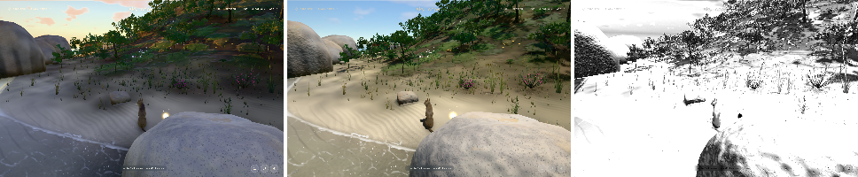 — time minutes=750; shadow-request jump=true; environment; shadow-swap slice=1 count=1
- 21160 ms [time 750] **sharp** step 66.6  — time minutes=750; shadow-request jump=true; environment; shadow-swap slice=1 count=1
- 21160 ms [time 750] **pop** 878336 px — time minutes=750; shadow-request jump=true; environment; shadow-swap slice=1 count=1
- 21160 ms [time 750] **vanish** 5888 px — time minutes=750; shadow-request jump=true; environment; shadow-swap slice=1 count=1
- 22577 ms [time 750] **flash** (moving) 1536 px — lod-pack 2 chunks
- 22577 ms [time 750] **vanish** (moving) 1792 px — lod-pack 2 chunks
- (19 pops while the camera moved; in stability.json)
- 465 ms [navigate] **hitch** 201 ms — no event
- 1065 ms [navigate] **hitch** 127 ms — no event
- 5066 ms [navigate] **hitch** 120 ms — prewarm-done slices=35 compiled=71 programs=90; prewarm-end; magic-pipelines
- time → 1145: settles in 4846 ms, 0 visible steps after the first frame, shadows swap 0 frames after the sun moves
- time → 750: settles in 5381 ms, 7 visible steps after the first frame, shadows swap 0 frames after the sun moves
- time → 1320: settles in 574 ms, 0 visible steps after the first frame, shadows swap 0 frames after the sun moves
- time → 750: settles in 4718 ms, 0 visible steps after the first frame, shadows swap 6 frames after the sun moves

## gift

- 1175 ms [navigate] **flash** (moving) 12032 px — animal-lod herd=herd coarse=true distance=29
- 1175 ms [navigate] **vanish** (moving) 4864 px 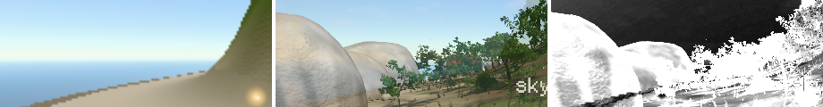 — animal-lod herd=herd coarse=true distance=29
- 2358 ms [navigate] **flash** 4608 px — animal-lod herd=herd coarse=true distance=61
- 2341 ms [navigate] **pop** 10240 px — no event
- 3491 ms [navigate] **lum** step -1.6 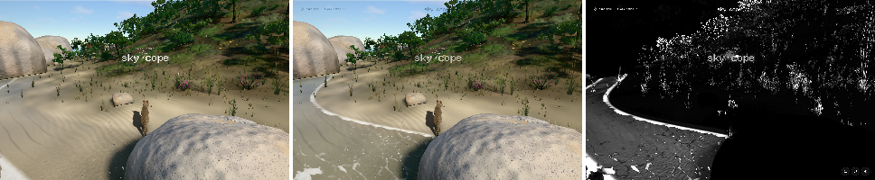 — no event
- 8891 ms [navigate] **flash** 768 px — environment
- 8891 ms [navigate] **vanish** 1024 px — environment
- 8958 ms [navigate] **pop** 768 px — no event
- 9441 ms [navigate] **flash** 768 px — no event
- 9674 ms [navigate] **pop** 1280 px — no event
- 9908 ms [navigate] **flash** 2304 px — no event
- 10041 ms [navigate] **flash** 2048 px — no event
- 10174 ms [navigate] **flash** 1792 px — no event
- 10308 ms [navigate] **flash** 1024 px — no event
- 10541 ms [navigate] **pop** 768 px — no event
- 10708 ms [navigate] **flash** 1024 px — no event
- 10808 ms [navigate] **flash** 1536 px — no event
- 10941 ms [navigate] **flash** 3072 px — no event
- 11074 ms [navigate] **flash** 2304 px — no event
- 11408 ms [navigate] **pop** 768 px — no event
- 11774 ms [navigate] **flash** 1792 px — no event
- 11974 ms [navigate] **flash** 1536 px — no event
- 12174 ms [navigate] **flash** 6144 px — no event
- 12441 ms [navigate] **flash** 8448 px — no event
- 12641 ms [navigate] **pop** 1024 px — no event
- 13141 ms [gift fireflies] **flash** 8704 px 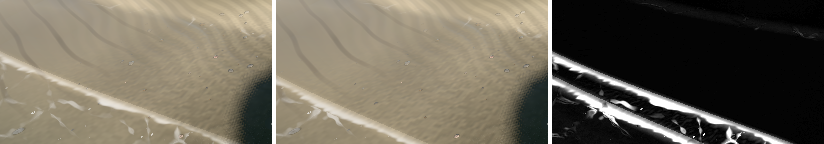 — no event
- 13407 ms [gift fireflies] **flash** 4352 px — no event
- 13574 ms [gift fireflies] **flash** 2048 px — no event
- 16007 ms [gift fireflies] **lum** step 0.82 — animal-lod herd=herd coarse=true distance=92
- 16907 ms [gift fireflies] **pop** 1024 px — no event
- 16907 ms [gift fireflies] **flash** 6400 px — no event
- 17074 ms [gift fireflies] **pop** 6400 px — no event
- 17074 ms [gift fireflies] **flash** 7680 px — no event
- 17507 ms [gift fireflies] **pop** 12544 px — no event
- 17541 ms [gift fireflies] **pop** 2560 px — no event
- 18074 ms [gift fireflies] **pop** 1536 px — no event
- 19307 ms [gift fireflies] **vanish** 768 px — no event
- 19707 ms [gift fireflies] **flash** 1024 px — no event
- 19907 ms [gift fireflies] **flash** 1024 px — no event
- 20141 ms [gift fireflies] **flash** 1536 px — no event
- (41 pops while the camera moved; in stability.json)
- 497 ms [navigate] **hitch** 325 ms — no event
- 1677 ms [navigate] **hitch** 255 ms — no event
- 3251 ms [navigate] **hitch** 146 ms — no event

## throttle

- 798 ms [navigate] **vanish** (moving) 2304 px 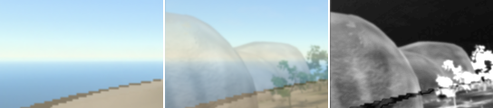 — no event
- 1348 ms [navigate] **pop** 768 px — animal-lod herd=herd coarse=true distance=29; animal-lod herd=herd coarse=true distance=61
- 1715 ms [navigate] **pop** 7168 px — no event
- 2031 ms [navigate] **lum** step -0.81 — no event
- 2381 ms [navigate] **pop** 7936 px — no event
- 2381 ms [navigate] **flash** 13824 px 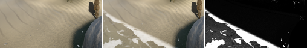 — no event
- 2698 ms [navigate] **lum** step -1.42 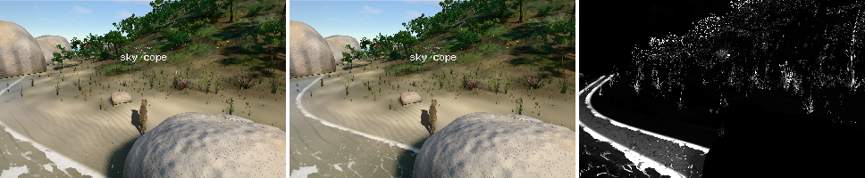 — no event
- 2698 ms [navigate] **pop** 26368 px 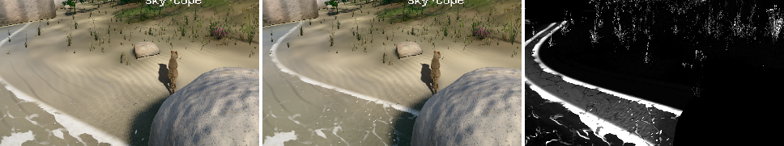 — no event
- 2698 ms [navigate] **flash** 2048 px — no event
- 2781 ms [navigate] **pop** 12032 px — no event
- 2781 ms [navigate] **flash** 1024 px — no event
- 2998 ms [navigate] **flash** 1280 px — no event
- 3381 ms [navigate] **pop** 768 px — prewarm-start
- 8831 ms [navigate] **vanish** 1024 px — no event
- 9031 ms [navigate] **flash** 1024 px — no event
- 9264 ms [navigate] **flash** 1536 px — no event
- 9764 ms [navigate] **flash** 2304 px — no event
- 9964 ms [navigate] **flash** 2560 px — environment
- 10131 ms [navigate] **flash** 1536 px — environment
- 10231 ms [navigate] **flash** 768 px — no event
- 10664 ms [navigate] **flash** 1792 px — quality from=0 to=1 cost=16
- 10964 ms [throttle 4x] **flash** 3584 px — quality from=0 to=1 cost=16
- 11248 ms [throttle 4x] **flash** 1792 px — no event
- 11731 ms [throttle 4x] **pop** 1024 px — no event
- 12348 ms [throttle 4x] **flash** 4352 px — no event
- 12431 ms [throttle 4x] **pop** 8448 px — no event
- 12764 ms [throttle 4x] **flash** 7936 px — no event
- 12914 ms [throttle 4x] **flash** 1280 px — no event
- 13081 ms [throttle 4x] **flash** 2816 px — no event
- 13364 ms [throttle 4x] **flash** 4352 px — no event
- 13581 ms [throttle 4x] **flash** 768 px — no event
- 16781 ms [throttle 4x] **pop** 1536 px — no event
- 16781 ms [throttle 4x] **flash** 7936 px — no event
- 17114 ms [throttle 4x] **pop** 10752 px — quality from=2 to=3 cost=40; resize layer=sea from=1280x800 to=1050x656 boundary=true
- 17114 ms [throttle 4x] **flash** 1792 px — quality from=2 to=3 cost=40; resize layer=sea from=1280x800 to=1050x656 boundary=true
- 17181 ms [throttle 4x] **pop** 9984 px — no event
- 17181 ms [throttle 4x] **flash** 1280 px — no event
- 17314 ms [throttle 4x] **pop** 768 px — no event
- 17314 ms [throttle 4x] **flash** 1280 px — no event
- 19797 ms [throttle 4x] **pop** 768 px — no event
- (187 pops while the camera moved; in stability.json)
- 503 ms [navigate] **hitch** 341 ms — no event
- 1271 ms [navigate] **hitch** 127 ms — no event
- 6342 ms [navigate] **hitch** 107 ms — no event

## routes

- 836 ms [navigate] **vanish** 2304 px 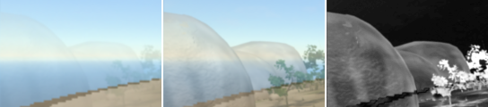 — no event
- 1002 ms [navigate] **lum** step -7.67 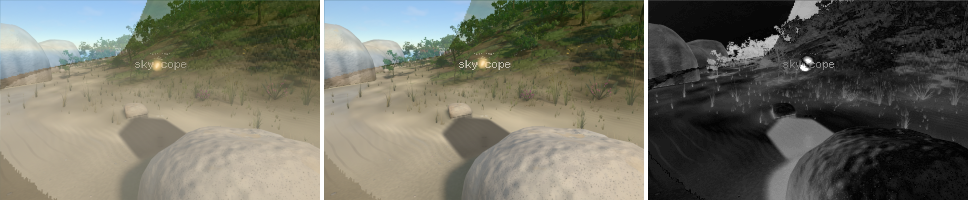 — no event
- 1002 ms [navigate] **sharp** step 23.1 — no event
- 1202 ms [navigate] **lum** step -6.02 — animal-lod herd=herd coarse=true distance=29; animal-lod herd=herd coarse=true distance=61
- 1202 ms [navigate] **sharp** step 408.8 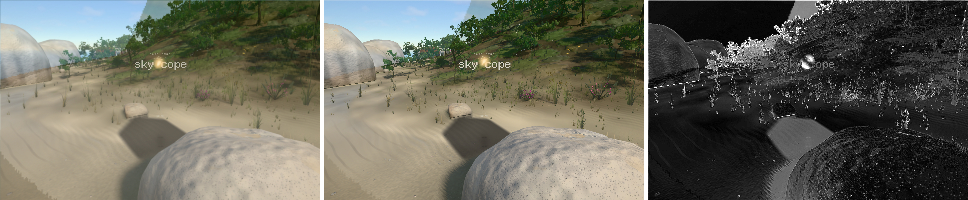 — animal-lod herd=herd coarse=true distance=29; animal-lod herd=herd coarse=true distance=61
- 1252 ms [navigate] **lum** step -1.08 — animal-lod herd=herd coarse=true distance=29; animal-lod herd=herd coarse=true distance=61
- 1419 ms [navigate] **sharp** step 11.2 — animal-lod herd=herd coarse=true distance=61
- 1419 ms [navigate] **pop** 27136 px — animal-lod herd=herd coarse=true distance=61
- 1419 ms [navigate] **vanish** 2560 px — animal-lod herd=herd coarse=true distance=61
- 1519 ms [navigate] **lum** step -1.04 — no event
- 1636 ms [navigate] **lum** step -0.92 — no event
- 2286 ms [navigate] **pop** 2816 px — no event
- 2286 ms [navigate] **flash** 2816 px — no event
- 2369 ms [navigate] **pop** 1024 px — no event
- 2369 ms [navigate] **flash** 7936 px — no event
- 2452 ms [navigate] **pop** 1792 px — no event
- 2452 ms [navigate] **flash** 12032 px — no event
- 2552 ms [navigate] **pop** 1280 px — no event
- 2552 ms [navigate] **flash** 8448 px — no event
- 2652 ms [navigate] **flash** 4096 px — no event
- 2719 ms [navigate] **flash** 1792 px — no event
- 2936 ms [navigate] **pop** 768 px — no event
- 7469 ms [navigate] **vanish** (moving) 4864 px — shadow-request jump=false; shadow-slice slice=1 count=4; place-lod place=893588 from=1 to=0 x=-4.456042089753154 z=38.35820823377907; lod-pack 34 chunks
- 8702 ms [navigate] **pop** 768 px — no event
- 8869 ms [navigate] **flash** 3072 px — no event
- 9002 ms [navigate] **flash** 768 px — no event
- 9302 ms [navigate] **pop** 1280 px — no event
- 9302 ms [navigate] **flash** 1024 px — no event
- 9302 ms [navigate] **vanish** 768 px — no event
- 10419 ms [foliage-walk] **flash** (moving) 57856 px 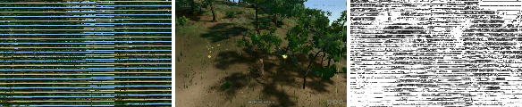 — no event
- 11835 ms [foliage-walk] **vanish** (moving) 2304 px — lod-pack 52 chunks
- 12569 ms [foliage-walk] **flash** (moving) 3840 px — quality from=0 to=1 cost=42; lod-pack 138 chunks
- 12569 ms [foliage-walk] **vanish** (moving) 28928 px — quality from=0 to=1 cost=42; lod-pack 138 chunks
- 12985 ms [foliage-walk] **vanish** (moving) 8704 px — lod-pack 80 chunks
- 13669 ms [foliage-walk] **flash** (moving) 22016 px — lod-pack 134 chunks
- 14135 ms [foliage-walk] **vanish** (moving) 3584 px — quality from=1 to=2 cost=33; resize layer=sky from=849x530 to=636x398 boundary=true; lod-pack 42 chunks
- 14468 ms [foliage-walk] **flash** (moving) 1024 px — lod-pack 7 chunks
- 14468 ms [foliage-walk] **vanish** (moving) 2304 px — lod-pack 7 chunks
- 14568 ms [foliage-walk] **vanish** (moving) 1280 px — lod-pack 10 chunks
- 15052 ms [foliage-walk] **vanish** (moving) 3840 px — lod-pack 15 chunks
- (332 pops while the camera moved; in stability.json)
- 397 ms [navigate] **hitch** 132 ms — no event
- 638 ms [navigate] **hitch** 411 ms — no event
