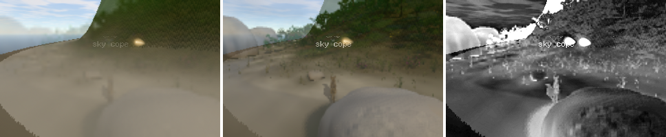
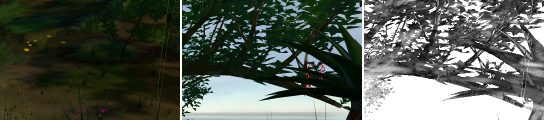

# Stability, 2026-11-15T06:40 (1280x800 @1, seed 1847)

| session | captured | seconds | blank | lum | sharp | popStill | popMoving | worstPopPixels | flashStill | flashMoving | vanishStill | vanishMoving | flicker | leafLight | leafSteps | hitches | worstHitchMs | resizes | unsynced | quality | reveal | shadowSwaps | placeLod | animalLod | errors |
| --- | --- | --- | --- | --- | --- | --- | --- | --- | --- | --- | --- | --- | --- | --- | --- | --- | --- | --- | --- | --- | --- | --- | --- | --- | --- |
| leaves | 612 | 53 | 0 | 8 | 6 | 12 | 51 | 5376 | 16 | 55 | 2 | 46 | 0.437 | 0.173 | 8 | 2 | 176 | 18 | 15 | 14 | 5 | 5 | 7 | 4 | 0 |

Columns: frames captured (screencast) and seconds rendered; blank frames; persistent luminance
and sharpness steps with the camera still; pops (abrupt local changes that stay) with the camera
still and moving, the worst still one in pixels; one-frame flashes; hitches (gaps of 100 ms+
between rendered frames) and the worst; canvas resizes and those outside the frame boundary;
budget level changes; reveal steps; shadow-map swaps; landmark and animal LOD switches.

## leaves

- 570 ms [navigate] **flash** 1536 px — reveal reveal=0.0625; resize layer=land from=40x25 to=80x50 boundary=false; resize layer=sea from=40x25 to=80x50 boundary=false; resize layer=sky from=40x25 to=80x50 boundary=false; environment
- 687 ms [navigate] **lum** step -6.18 — environment
- 687 ms [navigate] **sharp** step 10.1 — environment
- 687 ms [navigate] **flash** 768 px — environment
- 970 ms [navigate] **lum** step -18.96  — reveal reveal=0.125; resize layer=land from=80x50 to=160x100 boundary=false; resize layer=sea from=80x50 to=160x100 boundary=false; resize layer=sky from=80x50 to=160x100 boundary=false; environment
- 970 ms [navigate] **sharp** step 30.6 — reveal reveal=0.125; resize layer=land from=80x50 to=160x100 boundary=false; resize layer=sea from=80x50 to=160x100 boundary=false; resize layer=sky from=80x50 to=160x100 boundary=false; environment
- 970 ms [navigate] **flash** 1024 px — reveal reveal=0.125; resize layer=land from=80x50 to=160x100 boundary=false; resize layer=sea from=80x50 to=160x100 boundary=false; resize layer=sky from=80x50 to=160x100 boundary=false; environment
- 1137 ms [navigate] **lum** step -7.45 — environment; reveal reveal=0.25; resize layer=land from=160x100 to=320x200 boundary=false; resize layer=sea from=160x100 to=320x200 boundary=false; resize layer=sky from=160x100 to=320x200 boundary=false; environment
- 1137 ms [navigate] **sharp** step 28.9 — environment; reveal reveal=0.25; resize layer=land from=160x100 to=320x200 boundary=false; resize layer=sea from=160x100 to=320x200 boundary=false; resize layer=sky from=160x100 to=320x200 boundary=false; environment
- 1137 ms [navigate] **pop** 768 px — environment; reveal reveal=0.25; resize layer=land from=160x100 to=320x200 boundary=false; resize layer=sea from=160x100 to=320x200 boundary=false; resize layer=sky from=160x100 to=320x200 boundary=false; environment
- 1237 ms [navigate] **lum** step -3.27 — reveal reveal=0.25; resize layer=land from=160x100 to=320x200 boundary=false; resize layer=sea from=160x100 to=320x200 boundary=false; resize layer=sky from=160x100 to=320x200 boundary=false; environment
- 1337 ms [navigate] **lum** step -2.53 — environment; reveal reveal=0.5; resize layer=land from=320x200 to=640x400 boundary=false; resize layer=sea from=320x200 to=640x400 boundary=false; resize layer=sky from=320x200 to=640x400 boundary=false
- 1337 ms [navigate] **sharp** step 54.6 — environment; reveal reveal=0.5; resize layer=land from=320x200 to=640x400 boundary=false; resize layer=sea from=320x200 to=640x400 boundary=false; resize layer=sky from=320x200 to=640x400 boundary=false
- 1337 ms [navigate] **pop** 1024 px — environment; reveal reveal=0.5; resize layer=land from=320x200 to=640x400 boundary=false; resize layer=sea from=320x200 to=640x400 boundary=false; resize layer=sky from=320x200 to=640x400 boundary=false
- 1487 ms [navigate] **lum** step -2.68 — reveal reveal=0.5; resize layer=land from=320x200 to=640x400 boundary=false; resize layer=sea from=320x200 to=640x400 boundary=false; resize layer=sky from=320x200 to=640x400 boundary=false; environment
- 1487 ms [navigate] **sharp** step 4.1 — reveal reveal=0.5; resize layer=land from=320x200 to=640x400 boundary=false; resize layer=sea from=320x200 to=640x400 boundary=false; resize layer=sky from=320x200 to=640x400 boundary=false; environment
- 1737 ms [navigate] **lum** step -2.68 — environment; reveal reveal=1; resize layer=land from=640x400 to=1280x800 boundary=false; resize layer=sea from=640x400 to=1280x800 boundary=false; resize layer=sky from=640x400 to=849x530 boundary=false; environment
- 1737 ms [navigate] **sharp** step 203.1  — environment; reveal reveal=1; resize layer=land from=640x400 to=1280x800 boundary=false; resize layer=sea from=640x400 to=1280x800 boundary=false; resize layer=sky from=640x400 to=849x530 boundary=false; environment
- 1887 ms [navigate] **lum** step -0.87 — environment
- 2087 ms [navigate] **pop** 5376 px — environment
- 2087 ms [navigate] **flash** 9472 px  — environment
- 2370 ms [navigate] **pop** 5376 px — environment
- 2370 ms [navigate] **flash** 3840 px — environment
- 2570 ms [navigate] **pop** 1024 px — environment
- 2570 ms [navigate] **flash** 1792 px — environment
- 2720 ms [navigate] **flash** 1024 px — environment; environment
- 3003 ms [navigate] **pop** 768 px — environment
- 8570 ms [navigate] **flash** (moving) 1536 px — environment; shadow-request jump=true; animal-lod herd=herd coarse=true distance=65; shadow-swap slice=1 count=1; environment; place-lod place=dd2375 from=1 to=0 x=62 z=86; place-lod place=2fb194 from=2 to=1 x=63.934342677373984 z=126.81560463466371; lod-pack 379 chunks
- 8570 ms [navigate] **vanish** (moving) 3072 px  — environment; shadow-request jump=true; animal-lod herd=herd coarse=true distance=65; shadow-swap slice=1 count=1; environment; place-lod place=dd2375 from=1 to=0 x=62 z=86; place-lod place=2fb194 from=2 to=1 x=63.934342677373984 z=126.81560463466371; lod-pack 379 chunks
- 8603 ms [navigate] **flash** (moving) 3840 px — shadow-request jump=true; animal-lod herd=herd coarse=true distance=65; shadow-swap slice=1 count=1; environment; place-lod place=dd2375 from=1 to=0 x=62 z=86; place-lod place=2fb194 from=2 to=1 x=63.934342677373984 z=126.81560463466371; lod-pack 379 chunks
- 8703 ms [navigate] **vanish** (moving) 1792 px — shadow-request jump=true; animal-lod herd=herd coarse=true distance=65; shadow-swap slice=1 count=1; environment; place-lod place=dd2375 from=1 to=0 x=62 z=86; place-lod place=2fb194 from=2 to=1 x=63.934342677373984 z=126.81560463466371; lod-pack 379 chunks
- 9403 ms [navigate] **pop** 1792 px — environment
- 9870 ms [navigate] **pop** 768 px — environment
- 11770 ms [navigate] **pop** 1280 px — environment; environment
- 14436 ms [still] **pop** 1024 px — environment; environment
- 15636 ms [still] **pop** 768 px — animal-lod herd=herd coarse=true distance=164; environment
- 17169 ms [still] **flash** 768 px — environment
- 17336 ms [still] **flash** 768 px — environment
- 17469 ms [still] **flash** 768 px — environment
- 17669 ms [still] **flash** 1024 px — environment; quality from=4 to=5 cost=13; environment; lod-pack 61 chunks
- (51 pops while the camera moved; in stability.json)
- 543 ms [navigate] **hitch** 176 ms — no event
- 8440 ms [navigate] **hitch** 116 ms — shadow-request jump=true; lod-pack chunks=379; animal-lod herd=herd coarse=true distance=65; shadow-swap slice=1 count=1
