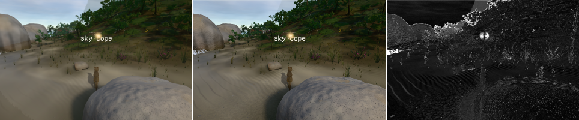
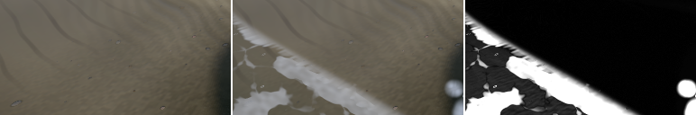

# Stability, 2026-11-15T06:27 (1280x800 @1, seed 1847)

| session | captured | seconds | blank | lum | sharp | popStill | popMoving | worstPopPixels | flashStill | flashMoving | vanishStill | vanishMoving | flicker | hitches | worstHitchMs | resizes | unsynced | quality | reveal | shadowSwaps | placeLod | animalLod | errors |
| --- | --- | --- | --- | --- | --- | --- | --- | --- | --- | --- | --- | --- | --- | --- | --- | --- | --- | --- | --- | --- | --- | --- | --- |
| leaves | 710 | 53.6 | 0 | 7 | 4 | 11 | 35 | 5376 | 8 | 31 | 2 | 43 | 0.399 | 3 | 213 | 20 | 15 | 10 | 5 | 4 | 7 | 4 | 0 |

Columns: frames captured (screencast) and seconds rendered; blank frames; persistent luminance
and sharpness steps with the camera still; pops (abrupt local changes that stay) with the camera
still and moving, the worst still one in pixels; one-frame flashes; hitches (gaps of 100 ms+
between rendered frames) and the worst; canvas resizes and those outside the frame boundary;
budget level changes; reveal steps; shadow-map swaps; landmark and animal LOD switches.

## leaves

- 928 ms [navigate] **lum** step -14.43  — reveal reveal=0.25; resize layer=land from=160x100 to=320x200 boundary=false; resize layer=sea from=160x100 to=320x200 boundary=false; resize layer=sky from=160x100 to=320x200 boundary=false; environment
- 928 ms [navigate] **sharp** step 44.9  — reveal reveal=0.25; resize layer=land from=160x100 to=320x200 boundary=false; resize layer=sea from=160x100 to=320x200 boundary=false; resize layer=sky from=160x100 to=320x200 boundary=false; environment
- 928 ms [navigate] **pop** 768 px — reveal reveal=0.25; resize layer=land from=160x100 to=320x200 boundary=false; resize layer=sea from=160x100 to=320x200 boundary=false; resize layer=sky from=160x100 to=320x200 boundary=false; environment
- 1044 ms [navigate] **lum** step -6.13  — reveal reveal=0.25; resize layer=land from=160x100 to=320x200 boundary=false; resize layer=sea from=160x100 to=320x200 boundary=false; resize layer=sky from=160x100 to=320x200 boundary=false; environment
- 1044 ms [navigate] **sharp** step 9.3 — reveal reveal=0.25; resize layer=land from=160x100 to=320x200 boundary=false; resize layer=sea from=160x100 to=320x200 boundary=false; resize layer=sky from=160x100 to=320x200 boundary=false; environment
- 1311 ms [navigate] **lum** step -8.87  — environment; reveal reveal=0.5; resize layer=land from=320x200 to=640x400 boundary=false; resize layer=sea from=320x200 to=640x400 boundary=false; resize layer=sky from=320x200 to=640x400 boundary=false; environment
- 1311 ms [navigate] **sharp** step 67.2  — environment; reveal reveal=0.5; resize layer=land from=320x200 to=640x400 boundary=false; resize layer=sea from=320x200 to=640x400 boundary=false; resize layer=sky from=320x200 to=640x400 boundary=false; environment
- 1544 ms [navigate] **lum** step -4.22 — reveal reveal=1; resize layer=land from=640x400 to=1280x800 boundary=false; resize layer=sea from=640x400 to=1280x800 boundary=false; resize layer=sky from=640x400 to=849x530 boundary=false; environment
- 1544 ms [navigate] **sharp** step 210.9  — reveal reveal=1; resize layer=land from=640x400 to=1280x800 boundary=false; resize layer=sea from=640x400 to=1280x800 boundary=false; resize layer=sky from=640x400 to=849x530 boundary=false; environment
- 1744 ms [navigate] **lum** step -1.98 — environment; environment
- 1928 ms [navigate] **lum** step -0.87 — environment
- 1928 ms [navigate] **flash** 1280 px — environment
- 2128 ms [navigate] **pop** 5376 px  — environment
- 2128 ms [navigate] **flash** 11264 px  — environment
- 2311 ms [navigate] **lum** step -0.91 — environment
- 2311 ms [navigate] **pop** 2048 px — environment
- 2311 ms [navigate] **flash** 5120 px  — environment
- 2544 ms [navigate] **pop** 3072 px  — environment; environment
- 2544 ms [navigate] **flash** 1792 px  — environment; environment
- 2778 ms [navigate] **flash** 1280 px — environment; environment
- 3011 ms [navigate] **pop** 768 px — environment; environment
- 3261 ms [navigate] **pop** 768 px — environment; environment
- 8444 ms [navigate] **vanish** (moving) 3072 px  — environment; shadow-request jump=true; animal-lod herd=herd coarse=true distance=64; shadow-swap slice=1 count=1; place-lod place=12c1ee from=1 to=0 x=62 z=86; place-lod place=3e849f from=2 to=1 x=63.934342677373984 z=126.81560463466371; lod-pack 379 chunks
- 9427 ms [navigate] **pop** 1024 px — environment; environment
- 9594 ms [navigate] **pop** 768 px — environment
- 11961 ms [navigate] **pop** 768 px — environment
- 14527 ms [still] **pop** 1024 px — environment
- 17060 ms [still] **flash** 1024 px — environment
- 17460 ms [still] **pop** 768 px — environment
- 17760 ms [still] **flash** 1024 px — environment
- 18160 ms [still] **flash** 768 px — environment
- 18160 ms [still] **vanish** 1024 px  — environment
- 18394 ms [still] **vanish** 768 px  — environment
- 22627 ms [still] **flash** (moving) 768 px — environment
- 22760 ms [still] **flash** (moving) 768 px — environment; lod-pack 1 chunks
- 22760 ms [still] **vanish** (moving) 768 px — environment; lod-pack 1 chunks
- 22893 ms [still] **flash** (moving) 768 px — environment; lod-pack 2 chunks
- 22893 ms [still] **vanish** (moving) 1024 px — environment; lod-pack 2 chunks
- 23027 ms [still] **flash** (moving) 768 px — environment; lod-pack 3 chunks
- 23027 ms [still] **vanish** (moving) 768 px — environment; lod-pack 3 chunks
- (35 pops while the camera moved; in stability.json)
- 548 ms [navigate] **hitch** 213 ms — reveal reveal=0.125; resize layer=land from=80x50 to=160x100 boundary=false; resize layer=sea from=80x50 to=160x100 boundary=false; resize layer=sky from=80x50 to=160x100 boundary=false
- 3366 ms [navigate] **hitch** 123 ms — prewarm-start; magic-pipelines
- 8300 ms [navigate] **hitch** 113 ms — environment; shadow-request jump=true; lod-pack chunks=379; animal-lod herd=herd coarse=true distance=64; shadow-swap slice=1 count=1
