# Stability, 2026-11-15T06:26 (1280x800 @1, seed 1847)

| session | captured | seconds | blank | lum | sharp | popStill | popMoving | worstPopPixels | flashStill | flashMoving | vanishStill | vanishMoving | flicker | hitches | worstHitchMs | resizes | unsynced | quality | reveal | shadowSwaps | placeLod | animalLod | errors |
| --- | --- | --- | --- | --- | --- | --- | --- | --- | --- | --- | --- | --- | --- | --- | --- | --- | --- | --- | --- | --- | --- | --- | --- |
| still | 998 | 62.9 | 0 | 16 | 13 | 22 | 52 | 4352 | 24 | 17 | 1 | 33 | 0.26 | 2 | 160 | 20 | 15 | 10 | 5 | 5 | 6 | 3 | 0 |
| walk | 708 | 48 | 0 | 9 | 7 | 23 | 131 | 12544 | 15 | 47 | 3 | 150 | 0.226 | 4 | 241 | 18 | 15 | 5 | 5 | 11 | 6 | 5 | 0 |
| orbit | 483 | 32.7 | 0 | 12 | 10 | 9 | 63 | 19968 | 9 | 17 | 0 | 145 | 0.264 | 4 | 165 | 18 | 15 | 7 | 5 | 35 | 6 | 19 | 0 |
| time | 783 | 43.7 | 0 | 17 | 13 | 14 | 33 | 892416 | 20 | 3 | 4 | 9 | 0.289 | 3 | 203 | 17 | 15 | 3 | 5 | 9 | 6 | 5 | 0 |
| gift | 627 | 34.5 | 0 | 4 | 5 | 16 | 17 | 29952 | 20 | 0 | 1 | 16 | 0.256 | 3 | 309 | 18 | 15 | 8 | 5 | 4 | 6 | 3 | 0 |
| throttle | 1052 | 72.4 | 0 | 9 | 8 | 28 | 59 | 11520 | 25 | 28 | 2 | 18 | 0.394 | 4 | 155 | 18 | 15 | 19 | 5 | 6 | 6 | 3 | 0 |
| routes | 803 | 66.7 | 1 | 8 | 10 | 32 | 311 | 20224 | 19 | 170 | 3 | 223 | 0.336 | 3 | 232 | 20 | 15 | 14 | 5 | 25 | 14 | 5 | 0 |

Columns: frames captured (screencast) and seconds rendered; blank frames; persistent luminance
and sharpness steps with the camera still; pops (abrupt local changes that stay) with the camera
still and moving, the worst still one in pixels; one-frame flashes; hitches (gaps of 100 ms+
between rendered frames) and the worst; canvas resizes and those outside the frame boundary;
budget level changes; reveal steps; shadow-map swaps; landmark and animal LOD switches.

## still

- 448 ms [navigate] **sharp** step 3.8 — reveal reveal=0.0625; resize layer=land from=40x25 to=80x50 boundary=false; resize layer=sea from=40x25 to=80x50 boundary=false; resize layer=sky from=40x25 to=80x50 boundary=false
- 515 ms [navigate] **lum** step -0.89 — no event
- 515 ms [navigate] **sharp** step 4.6 — no event
- 565 ms [navigate] **lum** step -1.15 — no event
- 565 ms [navigate] **sharp** step 4.3 — no event
- 631 ms [navigate] **lum** step -1.97 — no event
- 631 ms [navigate] **sharp** step 6.8 — no event
- 731 ms [navigate] **lum** step -3.47 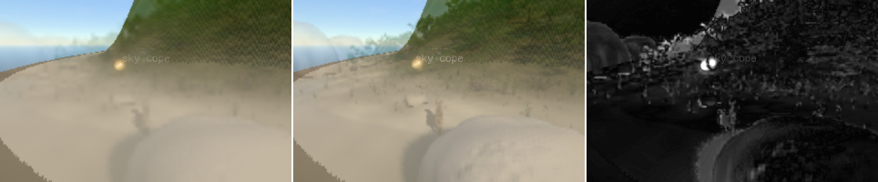 — reveal reveal=0.125; resize layer=land from=80x50 to=160x100 boundary=false; resize layer=sea from=80x50 to=160x100 boundary=false; resize layer=sky from=80x50 to=160x100 boundary=false
- 731 ms [navigate] **sharp** step 13.6 — reveal reveal=0.125; resize layer=land from=80x50 to=160x100 boundary=false; resize layer=sea from=80x50 to=160x100 boundary=false; resize layer=sky from=80x50 to=160x100 boundary=false
- 798 ms [navigate] **lum** step -3  — reveal reveal=0.125; resize layer=land from=80x50 to=160x100 boundary=false; resize layer=sea from=80x50 to=160x100 boundary=false; resize layer=sky from=80x50 to=160x100 boundary=false
- 798 ms [navigate] **sharp** step 4.8 — reveal reveal=0.125; resize layer=land from=80x50 to=160x100 boundary=false; resize layer=sea from=80x50 to=160x100 boundary=false; resize layer=sky from=80x50 to=160x100 boundary=false
- 831 ms [navigate] **lum** step -1.48 — reveal reveal=0.125; resize layer=land from=80x50 to=160x100 boundary=false; resize layer=sea from=80x50 to=160x100 boundary=false; resize layer=sky from=80x50 to=160x100 boundary=false
- 898 ms [navigate] **lum** step -2.75 — no event
- 898 ms [navigate] **sharp** step 4.8 — no event
- 931 ms [navigate] **lum** step -1.26 — no event
- 1015 ms [navigate] **lum** step -3  — reveal reveal=0.25; resize layer=land from=160x100 to=320x200 boundary=false; resize layer=sea from=160x100 to=320x200 boundary=false; resize layer=sky from=160x100 to=320x200 boundary=false
- 1015 ms [navigate] **sharp** step 31  — reveal reveal=0.25; resize layer=land from=160x100 to=320x200 boundary=false; resize layer=sea from=160x100 to=320x200 boundary=false; resize layer=sky from=160x100 to=320x200 boundary=false
- 1015 ms [navigate] **pop** 3584 px  — reveal reveal=0.25; resize layer=land from=160x100 to=320x200 boundary=false; resize layer=sea from=160x100 to=320x200 boundary=false; resize layer=sky from=160x100 to=320x200 boundary=false
- 1081 ms [navigate] **lum** step -1.83 — reveal reveal=0.25; resize layer=land from=160x100 to=320x200 boundary=false; resize layer=sea from=160x100 to=320x200 boundary=false; resize layer=sky from=160x100 to=320x200 boundary=false
- 1081 ms [navigate] **sharp** step 5.6 — reveal reveal=0.25; resize layer=land from=160x100 to=320x200 boundary=false; resize layer=sea from=160x100 to=320x200 boundary=false; resize layer=sky from=160x100 to=320x200 boundary=false
- 1198 ms [navigate] **lum** step -2.07 — reveal reveal=0.5; resize layer=land from=320x200 to=640x400 boundary=false; resize layer=sea from=320x200 to=640x400 boundary=false; resize layer=sky from=320x200 to=640x400 boundary=false
- 1198 ms [navigate] **sharp** step 6 — reveal reveal=0.5; resize layer=land from=320x200 to=640x400 boundary=false; resize layer=sea from=320x200 to=640x400 boundary=false; resize layer=sky from=320x200 to=640x400 boundary=false
- 1315 ms [navigate] **lum** step -1.76 — reveal reveal=0.5; resize layer=land from=320x200 to=640x400 boundary=false; resize layer=sea from=320x200 to=640x400 boundary=false; resize layer=sky from=320x200 to=640x400 boundary=false
- 1315 ms [navigate] **sharp** step 80  — reveal reveal=0.5; resize layer=land from=320x200 to=640x400 boundary=false; resize layer=sea from=320x200 to=640x400 boundary=false; resize layer=sky from=320x200 to=640x400 boundary=false
- 1315 ms [navigate] **pop** 768 px — reveal reveal=0.5; resize layer=land from=320x200 to=640x400 boundary=false; resize layer=sea from=320x200 to=640x400 boundary=false; resize layer=sky from=320x200 to=640x400 boundary=false
- 1415 ms [navigate] **lum** step -0.96 — reveal reveal=0.5; resize layer=land from=320x200 to=640x400 boundary=false; resize layer=sea from=320x200 to=640x400 boundary=false; resize layer=sky from=320x200 to=640x400 boundary=false
- 1531 ms [navigate] **lum** step -0.98 — reveal reveal=1; resize layer=land from=640x400 to=1280x800 boundary=false; resize layer=sea from=640x400 to=1280x800 boundary=false; resize layer=sky from=640x400 to=849x530 boundary=false; environment
- 1531 ms [navigate] **sharp** step 245.5  — reveal reveal=1; resize layer=land from=640x400 to=1280x800 boundary=false; resize layer=sea from=640x400 to=1280x800 boundary=false; resize layer=sky from=640x400 to=849x530 boundary=false; environment
- 1965 ms [revealed] **pop** 4352 px 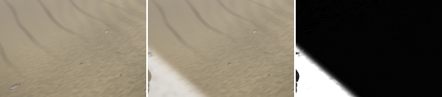 — no event
- 1981 ms [revealed] **pop** 1280 px — no event
- 2065 ms [revealed] **pop** 1280 px — no event
- 2065 ms [revealed] **flash** 10240 px  — no event
- 2131 ms [revealed] **flash** 11264 px  — no event
- 2198 ms [revealed] **flash** 10240 px — no event
- 2331 ms [revealed] **lum** step -0.83 — no event
- 2331 ms [revealed] **pop** 1024 px — no event
- 2331 ms [revealed] **flash** 1536 px — no event
- 2365 ms [revealed] **pop** 3584 px  — no event
- 2465 ms [revealed] **flash** 2816 px — no event
- 2598 ms [revealed] **pop** 768 px — no event
- (52 pops while the camera moved; in stability.json)
- 501 ms [navigate] **hitch** 160 ms — no event
- 3517 ms [revealed] **hitch** 136 ms — prewarm-start; magic-pipelines

## walk

- 831 ms [navigate] **lum** step -9.88 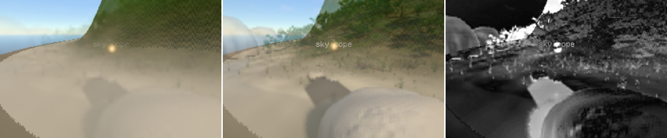 — animal-lod herd=herd coarse=true distance=29; reveal reveal=0.125; resize layer=land from=80x50 to=160x100 boundary=false; resize layer=sea from=80x50 to=160x100 boundary=false; resize layer=sky from=80x50 to=160x100 boundary=false
- 831 ms [navigate] **sharp** step 23.7 — animal-lod herd=herd coarse=true distance=29; reveal reveal=0.125; resize layer=land from=80x50 to=160x100 boundary=false; resize layer=sea from=80x50 to=160x100 boundary=false; resize layer=sky from=80x50 to=160x100 boundary=false
- 831 ms [navigate] **vanish** 3840 px 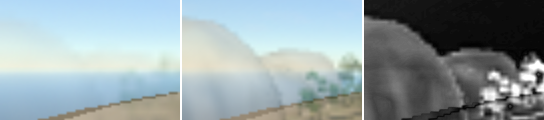 — animal-lod herd=herd coarse=true distance=29; reveal reveal=0.125; resize layer=land from=80x50 to=160x100 boundary=false; resize layer=sea from=80x50 to=160x100 boundary=false; resize layer=sky from=80x50 to=160x100 boundary=false
- 931 ms [navigate] **lum** step -4.33  — animal-lod herd=herd coarse=true distance=29; reveal reveal=0.125; resize layer=land from=80x50 to=160x100 boundary=false; resize layer=sea from=80x50 to=160x100 boundary=false; resize layer=sky from=80x50 to=160x100 boundary=false
- 931 ms [navigate] **sharp** step 7.7 — animal-lod herd=herd coarse=true distance=29; reveal reveal=0.125; resize layer=land from=80x50 to=160x100 boundary=false; resize layer=sea from=80x50 to=160x100 boundary=false; resize layer=sky from=80x50 to=160x100 boundary=false
- 964 ms [navigate] **lum** step -1.24 — no event
- 1064 ms [navigate] **lum** step -3.53  — animal-lod herd=herd coarse=true distance=61; reveal reveal=0.25; resize layer=land from=160x100 to=320x200 boundary=false; resize layer=sea from=160x100 to=320x200 boundary=false; resize layer=sky from=160x100 to=320x200 boundary=false
- 1064 ms [navigate] **sharp** step 32.2  — animal-lod herd=herd coarse=true distance=61; reveal reveal=0.25; resize layer=land from=160x100 to=320x200 boundary=false; resize layer=sea from=160x100 to=320x200 boundary=false; resize layer=sky from=160x100 to=320x200 boundary=false
- 1064 ms [navigate] **pop** 4096 px — animal-lod herd=herd coarse=true distance=61; reveal reveal=0.25; resize layer=land from=160x100 to=320x200 boundary=false; resize layer=sea from=160x100 to=320x200 boundary=false; resize layer=sky from=160x100 to=320x200 boundary=false
- 1097 ms [navigate] **lum** step -0.89 — animal-lod herd=herd coarse=true distance=61; reveal reveal=0.25; resize layer=land from=160x100 to=320x200 boundary=false; resize layer=sea from=160x100 to=320x200 boundary=false; resize layer=sky from=160x100 to=320x200 boundary=false
- 1197 ms [navigate] **sharp** step 7 — animal-lod herd=herd coarse=true distance=61; reveal reveal=0.25; resize layer=land from=160x100 to=320x200 boundary=false; resize layer=sea from=160x100 to=320x200 boundary=false; resize layer=sky from=160x100 to=320x200 boundary=false
- 1197 ms [navigate] **pop** 6912 px  — animal-lod herd=herd coarse=true distance=61; reveal reveal=0.25; resize layer=land from=160x100 to=320x200 boundary=false; resize layer=sea from=160x100 to=320x200 boundary=false; resize layer=sky from=160x100 to=320x200 boundary=false
- 1314 ms [navigate] **lum** step -1.51 — reveal reveal=0.5; resize layer=land from=320x200 to=640x400 boundary=false; resize layer=sea from=320x200 to=640x400 boundary=false; resize layer=sky from=320x200 to=640x400 boundary=false
- 1314 ms [navigate] **sharp** step 78.8  — reveal reveal=0.5; resize layer=land from=320x200 to=640x400 boundary=false; resize layer=sea from=320x200 to=640x400 boundary=false; resize layer=sky from=320x200 to=640x400 boundary=false
- 1314 ms [navigate] **pop** 768 px — reveal reveal=0.5; resize layer=land from=320x200 to=640x400 boundary=false; resize layer=sea from=320x200 to=640x400 boundary=false; resize layer=sky from=320x200 to=640x400 boundary=false
- 1514 ms [navigate] **lum** step -0.89 — reveal reveal=1; resize layer=land from=640x400 to=1280x800 boundary=false; resize layer=sea from=640x400 to=1280x800 boundary=false; resize layer=sky from=640x400 to=849x530 boundary=false
- 1614 ms [navigate] **sharp** step 245.9  — reveal reveal=1; resize layer=land from=640x400 to=1280x800 boundary=false; resize layer=sea from=640x400 to=1280x800 boundary=false; resize layer=sky from=640x400 to=849x530 boundary=false
- 1614 ms [navigate] **pop** 768 px — reveal reveal=1; resize layer=land from=640x400 to=1280x800 boundary=false; resize layer=sea from=640x400 to=1280x800 boundary=false; resize layer=sky from=640x400 to=849x530 boundary=false
- 1797 ms [navigate] **pop** 768 px — no event
- 2064 ms [navigate] **pop** 3840 px — no event
- 2064 ms [navigate] **flash** 5120 px — no event
- 2197 ms [navigate] **pop** 2304 px — no event
- 2197 ms [navigate] **flash** 7680 px — no event
- 2230 ms [navigate] **pop** 12544 px 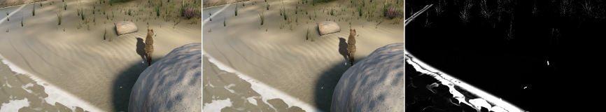 — environment
- 2230 ms [navigate] **flash** 6144 px — environment
- 2314 ms [navigate] **flash** 9728 px  — environment
- 2480 ms [navigate] **lum** step -0.89 — environment
- 2480 ms [navigate] **pop** 1280 px — environment
- 2497 ms [navigate] **pop** 2304 px — no event
- 8830 ms [navigate] **vanish** 768 px  — no event
- 9530 ms [navigate] **flash** 768 px — no event
- 9663 ms [navigate] **flash** 1536 px — no event
- 9730 ms [navigate] **flash** 768 px — no event
- 10763 ms [walk] **flash** (moving) 1280 px — lod-pack 3 chunks
- 10997 ms [walk] **flash** (moving) 4352 px — lod-pack 3 chunks
- 11080 ms [walk] **flash** (moving) 3328 px — lod-pack 6 chunks
- 11147 ms [walk] **flash** (moving) 3072 px — lod-pack 9 chunks
- 11213 ms [walk] **flash** (moving) 5632 px — lod-pack 14 chunks
- 11280 ms [walk] **flash** (moving) 7680 px — lod-pack 14 chunks
- 11513 ms [walk] **flash** (moving) 1536 px — lod-pack 24 chunks
- (131 pops while the camera moved; in stability.json)
- 471 ms [navigate] **hitch** 241 ms — no event
- 3401 ms [navigate] **hitch** 112 ms — prewarm-start; magic-pipelines
- 3549 ms [navigate] **hitch** 125 ms — prewarm-end
- 10016 ms [navigate] **hitch** 169 ms — no event

## orbit

- 531 ms [navigate] **lum** step -1.88 — animal-lod herd=herd coarse=true distance=29
- 531 ms [navigate] **sharp** step 6.8 — animal-lod herd=herd coarse=true distance=29
- 615 ms [navigate] **lum** step -2.44 — animal-lod herd=herd coarse=true distance=29
- 615 ms [navigate] **sharp** step 7.6 — animal-lod herd=herd coarse=true distance=29
- 715 ms [navigate] **lum** step -4.24 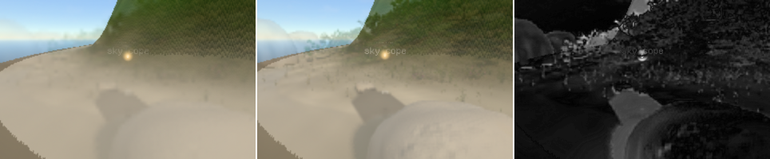 — reveal reveal=0.125; resize layer=land from=80x50 to=160x100 boundary=false; resize layer=sea from=80x50 to=160x100 boundary=false; resize layer=sky from=80x50 to=160x100 boundary=false; animal-lod herd=herd coarse=true distance=61
- 715 ms [navigate] **sharp** step 14.4 — reveal reveal=0.125; resize layer=land from=80x50 to=160x100 boundary=false; resize layer=sea from=80x50 to=160x100 boundary=false; resize layer=sky from=80x50 to=160x100 boundary=false; animal-lod herd=herd coarse=true distance=61
- 798 ms [navigate] **lum** step -4.04  — reveal reveal=0.125; resize layer=land from=80x50 to=160x100 boundary=false; resize layer=sea from=80x50 to=160x100 boundary=false; resize layer=sky from=80x50 to=160x100 boundary=false; animal-lod herd=herd coarse=true distance=61
- 798 ms [navigate] **sharp** step 6.6 — reveal reveal=0.125; resize layer=land from=80x50 to=160x100 boundary=false; resize layer=sea from=80x50 to=160x100 boundary=false; resize layer=sky from=80x50 to=160x100 boundary=false; animal-lod herd=herd coarse=true distance=61
- 865 ms [navigate] **lum** step -3.24  — animal-lod herd=herd coarse=true distance=61
- 948 ms [navigate] **lum** step -2.1 — reveal reveal=0.25; resize layer=land from=160x100 to=320x200 boundary=false; resize layer=sea from=160x100 to=320x200 boundary=false; resize layer=sky from=160x100 to=320x200 boundary=false
- 948 ms [navigate] **sharp** step 32.6  — reveal reveal=0.25; resize layer=land from=160x100 to=320x200 boundary=false; resize layer=sea from=160x100 to=320x200 boundary=false; resize layer=sky from=160x100 to=320x200 boundary=false
- 948 ms [navigate] **pop** 19968 px 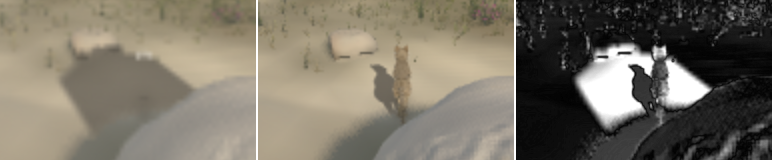 — reveal reveal=0.25; resize layer=land from=160x100 to=320x200 boundary=false; resize layer=sea from=160x100 to=320x200 boundary=false; resize layer=sky from=160x100 to=320x200 boundary=false
- 1048 ms [navigate] **lum** step -3.08 — reveal reveal=0.25; resize layer=land from=160x100 to=320x200 boundary=false; resize layer=sea from=160x100 to=320x200 boundary=false; resize layer=sky from=160x100 to=320x200 boundary=false
- 1048 ms [navigate] **sharp** step 8.4 — reveal reveal=0.25; resize layer=land from=160x100 to=320x200 boundary=false; resize layer=sea from=160x100 to=320x200 boundary=false; resize layer=sky from=160x100 to=320x200 boundary=false
- 1131 ms [navigate] **lum** step -2.08 — reveal reveal=0.25; resize layer=land from=160x100 to=320x200 boundary=false; resize layer=sea from=160x100 to=320x200 boundary=false; resize layer=sky from=160x100 to=320x200 boundary=false
- 1131 ms [navigate] **sharp** step 5.5 — reveal reveal=0.25; resize layer=land from=160x100 to=320x200 boundary=false; resize layer=sea from=160x100 to=320x200 boundary=false; resize layer=sky from=160x100 to=320x200 boundary=false
- 1231 ms [navigate] **lum** step -2.14 — reveal reveal=0.5; resize layer=land from=320x200 to=640x400 boundary=false; resize layer=sea from=320x200 to=640x400 boundary=false; resize layer=sky from=320x200 to=640x400 boundary=false
- 1231 ms [navigate] **sharp** step 79.6  — reveal reveal=0.5; resize layer=land from=320x200 to=640x400 boundary=false; resize layer=sea from=320x200 to=640x400 boundary=false; resize layer=sky from=320x200 to=640x400 boundary=false
- 1231 ms [navigate] **pop** 768 px — reveal reveal=0.5; resize layer=land from=320x200 to=640x400 boundary=false; resize layer=sea from=320x200 to=640x400 boundary=false; resize layer=sky from=320x200 to=640x400 boundary=false
- 1415 ms [navigate] **lum** step -1.9 — reveal reveal=0.5; resize layer=land from=320x200 to=640x400 boundary=false; resize layer=sea from=320x200 to=640x400 boundary=false; resize layer=sky from=320x200 to=640x400 boundary=false; environment
- 1415 ms [navigate] **sharp** step 6 — reveal reveal=0.5; resize layer=land from=320x200 to=640x400 boundary=false; resize layer=sea from=320x200 to=640x400 boundary=false; resize layer=sky from=320x200 to=640x400 boundary=false; environment
- 1565 ms [navigate] **lum** step -1.21 — environment; reveal reveal=1; resize layer=land from=640x400 to=1280x800 boundary=false; resize layer=sea from=640x400 to=1280x800 boundary=false; resize layer=sky from=640x400 to=849x530 boundary=false
- 1565 ms [navigate] **sharp** step 247.9  — environment; reveal reveal=1; resize layer=land from=640x400 to=1280x800 boundary=false; resize layer=sea from=640x400 to=1280x800 boundary=false; resize layer=sky from=640x400 to=849x530 boundary=false
- 1998 ms [navigate] **pop** 4608 px — no event
- 1998 ms [navigate] **flash** 8704 px 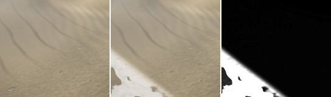 — no event
- 2165 ms [navigate] **pop** 6656 px — no event
- 2165 ms [navigate] **flash** 1024 px — no event
- 2181 ms [navigate] **pop** 17920 px  — no event
- 2348 ms [navigate] **lum** step -1.13 — no event
- 2348 ms [navigate] **pop** 3328 px — no event
- 2348 ms [navigate] **flash** 4352 px  — no event
- 2431 ms [navigate] **pop** 2304 px — no event
- 2431 ms [navigate] **flash** 2048 px  — no event
- 2498 ms [navigate] **pop** 1024 px — no event
- 2581 ms [navigate] **pop** 768 px — no event
- 9448 ms [navigate] **flash** 768 px — environment
- 9582 ms [navigate] **flash** 768 px — no event
- 9648 ms [navigate] **flash** 768 px — no event
- 9715 ms [navigate] **flash** 768 px — no event
- 9782 ms [navigate] **flash** 1024 px — no event
- (63 pops while the camera moved; in stability.json)
- 468 ms [navigate] **hitch** 155 ms — no event
- 3553 ms [navigate] **hitch** 135 ms — prewarm-start; magic-pipelines
- 3720 ms [navigate] **hitch** 165 ms — prewarm-end
- 17469 ms [orbit] **hitch** 157 ms — lod-pack chunks=39; shadow-slice slice=6 count=8; lod-pack chunks=36; shadow-slice slice=7 count=8

## time

- 474 ms [navigate] **lum** step -1.14 — reveal reveal=0.0625; resize layer=land from=40x25 to=80x50 boundary=false; resize layer=sea from=40x25 to=80x50 boundary=false; resize layer=sky from=40x25 to=80x50 boundary=false; animal-lod herd=herd coarse=true distance=29
- 474 ms [navigate] **sharp** step 8.4 — reveal reveal=0.0625; resize layer=land from=40x25 to=80x50 boundary=false; resize layer=sea from=40x25 to=80x50 boundary=false; resize layer=sky from=40x25 to=80x50 boundary=false; animal-lod herd=herd coarse=true distance=29
- 557 ms [navigate] **lum** step -1.8 — animal-lod herd=herd coarse=true distance=29
- 557 ms [navigate] **sharp** step 7.1 — animal-lod herd=herd coarse=true distance=29
- 657 ms [navigate] **lum** step -2.75 — no event
- 657 ms [navigate] **sharp** step 7 — no event
- 741 ms [navigate] **lum** step -3.5 — animal-lod herd=herd coarse=true distance=61; reveal reveal=0.125; resize layer=land from=80x50 to=160x100 boundary=false; resize layer=sea from=80x50 to=160x100 boundary=false; resize layer=sky from=80x50 to=160x100 boundary=false
- 741 ms [navigate] **sharp** step 6.4 — animal-lod herd=herd coarse=true distance=61; reveal reveal=0.125; resize layer=land from=80x50 to=160x100 boundary=false; resize layer=sea from=80x50 to=160x100 boundary=false; resize layer=sky from=80x50 to=160x100 boundary=false
- 824 ms [navigate] **lum** step -3.93 — animal-lod herd=herd coarse=true distance=61; reveal reveal=0.125; resize layer=land from=80x50 to=160x100 boundary=false; resize layer=sea from=80x50 to=160x100 boundary=false; resize layer=sky from=80x50 to=160x100 boundary=false
- 824 ms [navigate] **sharp** step 13.5 — animal-lod herd=herd coarse=true distance=61; reveal reveal=0.125; resize layer=land from=80x50 to=160x100 boundary=false; resize layer=sea from=80x50 to=160x100 boundary=false; resize layer=sky from=80x50 to=160x100 boundary=false
- 941 ms [navigate] **lum** step -3.91 — animal-lod herd=herd coarse=true distance=61; reveal reveal=0.125; resize layer=land from=80x50 to=160x100 boundary=false; resize layer=sea from=80x50 to=160x100 boundary=false; resize layer=sky from=80x50 to=160x100 boundary=false
- 941 ms [navigate] **sharp** step 8 — animal-lod herd=herd coarse=true distance=61; reveal reveal=0.125; resize layer=land from=80x50 to=160x100 boundary=false; resize layer=sea from=80x50 to=160x100 boundary=false; resize layer=sky from=80x50 to=160x100 boundary=false
- 974 ms [navigate] **lum** step -1.13 — no event
- 1074 ms [navigate] **lum** step -3.15 — reveal reveal=0.25; resize layer=land from=160x100 to=320x200 boundary=false; resize layer=sea from=160x100 to=320x200 boundary=false; resize layer=sky from=160x100 to=320x200 boundary=false
- 1074 ms [navigate] **sharp** step 33 — reveal reveal=0.25; resize layer=land from=160x100 to=320x200 boundary=false; resize layer=sea from=160x100 to=320x200 boundary=false; resize layer=sky from=160x100 to=320x200 boundary=false
- 1074 ms [navigate] **pop** 3840 px — reveal reveal=0.25; resize layer=land from=160x100 to=320x200 boundary=false; resize layer=sea from=160x100 to=320x200 boundary=false; resize layer=sky from=160x100 to=320x200 boundary=false
- 1207 ms [navigate] **lum** step -2.41 — reveal reveal=0.25; resize layer=land from=160x100 to=320x200 boundary=false; resize layer=sea from=160x100 to=320x200 boundary=false; resize layer=sky from=160x100 to=320x200 boundary=false
- 1207 ms [navigate] **sharp** step 6.1 — reveal reveal=0.25; resize layer=land from=160x100 to=320x200 boundary=false; resize layer=sea from=160x100 to=320x200 boundary=false; resize layer=sky from=160x100 to=320x200 boundary=false
- 1207 ms [navigate] **vanish** 2048 px 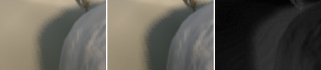 — reveal reveal=0.25; resize layer=land from=160x100 to=320x200 boundary=false; resize layer=sea from=160x100 to=320x200 boundary=false; resize layer=sky from=160x100 to=320x200 boundary=false
- 1291 ms [navigate] **lum** step -1.01 — reveal reveal=0.5; resize layer=land from=320x200 to=640x400 boundary=false; resize layer=sea from=320x200 to=640x400 boundary=false; resize layer=sky from=320x200 to=640x400 boundary=false
- 1391 ms [navigate] **lum** step -1.47 — reveal reveal=0.5; resize layer=land from=320x200 to=640x400 boundary=false; resize layer=sea from=320x200 to=640x400 boundary=false; resize layer=sky from=320x200 to=640x400 boundary=false
- 1391 ms [navigate] **sharp** step 79.8  — reveal reveal=0.5; resize layer=land from=320x200 to=640x400 boundary=false; resize layer=sea from=320x200 to=640x400 boundary=false; resize layer=sky from=320x200 to=640x400 boundary=false
- 1391 ms [navigate] **pop** 768 px — reveal reveal=0.5; resize layer=land from=320x200 to=640x400 boundary=false; resize layer=sea from=320x200 to=640x400 boundary=false; resize layer=sky from=320x200 to=640x400 boundary=false
- 1491 ms [navigate] **lum** step -0.96 — reveal reveal=0.5; resize layer=land from=320x200 to=640x400 boundary=false; resize layer=sea from=320x200 to=640x400 boundary=false; resize layer=sky from=320x200 to=640x400 boundary=false
- 1674 ms [navigate] **lum** step -1.18 — reveal reveal=1; resize layer=land from=640x400 to=1280x800 boundary=false; resize layer=sea from=640x400 to=1280x800 boundary=false; resize layer=sky from=640x400 to=849x530 boundary=false
- 1674 ms [navigate] **sharp** step 250.1 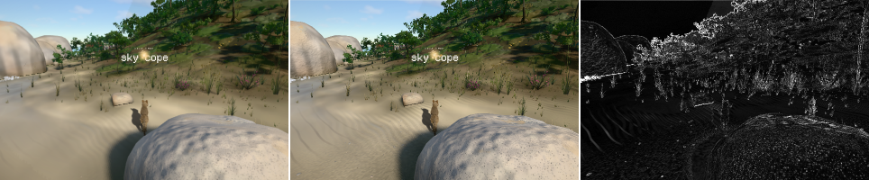 — reveal reveal=1; resize layer=land from=640x400 to=1280x800 boundary=false; resize layer=sea from=640x400 to=1280x800 boundary=false; resize layer=sky from=640x400 to=849x530 boundary=false
- 1991 ms [navigate] **pop** 2048 px — no event
- 2107 ms [navigate] **pop** 3840 px — no event
- 2107 ms [navigate] **flash** 5632 px — no event
- 2174 ms [navigate] **pop** 1024 px — no event
- 2174 ms [navigate] **flash** 6912 px  — no event
- 2241 ms [navigate] **flash** 10752 px  — no event
- 2407 ms [navigate] **lum** step -1.03 — environment
- 2407 ms [navigate] **pop** 3328 px — environment
- 2407 ms [navigate] **flash** 2304 px — environment
- 2457 ms [navigate] **pop** 4096 px — environment
- 2624 ms [navigate] **pop** 768 px — environment
- 2657 ms [navigate] **pop** 1280 px — no event
- 9640 ms [navigate] **flash** 768 px — no event
- 9807 ms [navigate] **flash** 768 px — no event
- (33 pops while the camera moved; in stability.json)
- 512 ms [navigate] **hitch** 203 ms — no event
- 3478 ms [navigate] **hitch** 146 ms — prewarm-start; magic-pipelines
- 3660 ms [navigate] **hitch** 142 ms — prewarm-end
- time → 1145: settles in 130 ms, 0 visible steps after the first frame, shadows swap 3 frames after the sun moves
- time → 750: settles in 5959 ms, 1 visible steps after the first frame, shadows swap 3 frames after the sun moves
- time → 1320: settles in 289 ms, 0 visible steps after the first frame, shadows swap 3 frames after the sun moves
- time → 750: settles in 4001 ms, 1 visible steps after the first frame, shadows swap 7 frames after the sun moves

## gift

- 962 ms [navigate] **pop** 768 px — animal-lod herd=herd coarse=true distance=29; reveal reveal=0.125; resize layer=land from=80x50 to=160x100 boundary=false; resize layer=sea from=80x50 to=160x100 boundary=false; resize layer=sky from=80x50 to=160x100 boundary=false
- 962 ms [navigate] **vanish** 6912 px 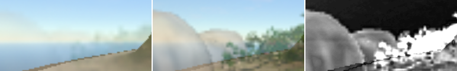 — animal-lod herd=herd coarse=true distance=29; reveal reveal=0.125; resize layer=land from=80x50 to=160x100 boundary=false; resize layer=sea from=80x50 to=160x100 boundary=false; resize layer=sky from=80x50 to=160x100 boundary=false
- 1162 ms [navigate] **lum** step -6.26 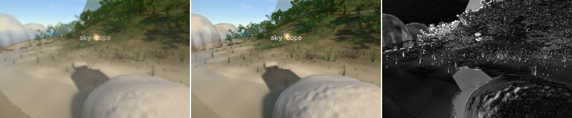 — reveal reveal=0.25; resize layer=land from=160x100 to=320x200 boundary=false; resize layer=sea from=160x100 to=320x200 boundary=false; resize layer=sky from=160x100 to=320x200 boundary=false
- 1162 ms [navigate] **sharp** step 40.9  — reveal reveal=0.25; resize layer=land from=160x100 to=320x200 boundary=false; resize layer=sea from=160x100 to=320x200 boundary=false; resize layer=sky from=160x100 to=320x200 boundary=false
- 1162 ms [navigate] **pop** 1536 px — reveal reveal=0.25; resize layer=land from=160x100 to=320x200 boundary=false; resize layer=sea from=160x100 to=320x200 boundary=false; resize layer=sky from=160x100 to=320x200 boundary=false
- 1296 ms [navigate] **lum** step -2.58  — reveal reveal=0.25; resize layer=land from=160x100 to=320x200 boundary=false; resize layer=sea from=160x100 to=320x200 boundary=false; resize layer=sky from=160x100 to=320x200 boundary=false; animal-lod herd=herd coarse=true distance=61
- 1296 ms [navigate] **sharp** step 5.5 — reveal reveal=0.25; resize layer=land from=160x100 to=320x200 boundary=false; resize layer=sea from=160x100 to=320x200 boundary=false; resize layer=sky from=160x100 to=320x200 boundary=false; animal-lod herd=herd coarse=true distance=61
- 1512 ms [navigate] **sharp** step 84.5  — reveal reveal=0.5; resize layer=land from=320x200 to=640x400 boundary=false; resize layer=sea from=320x200 to=640x400 boundary=false; resize layer=sky from=320x200 to=640x400 boundary=false
- 1512 ms [navigate] **pop** 29952 px 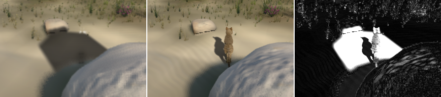 — reveal reveal=0.5; resize layer=land from=320x200 to=640x400 boundary=false; resize layer=sea from=320x200 to=640x400 boundary=false; resize layer=sky from=320x200 to=640x400 boundary=false
- 1696 ms [navigate] **lum** step -0.8 — reveal reveal=0.5; resize layer=land from=320x200 to=640x400 boundary=false; resize layer=sea from=320x200 to=640x400 boundary=false; resize layer=sky from=320x200 to=640x400 boundary=false
- 1846 ms [navigate] **sharp** step 246.7 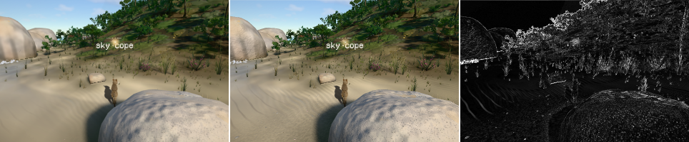 — reveal reveal=1; resize layer=land from=640x400 to=1280x800 boundary=false; resize layer=sea from=640x400 to=1280x800 boundary=false; resize layer=sky from=640x400 to=849x530 boundary=false
- 1846 ms [navigate] **pop** 768 px — reveal reveal=1; resize layer=land from=640x400 to=1280x800 boundary=false; resize layer=sea from=640x400 to=1280x800 boundary=false; resize layer=sky from=640x400 to=849x530 boundary=false
- 2262 ms [navigate] **pop** 8192 px — no event
- 2262 ms [navigate] **flash** 13312 px 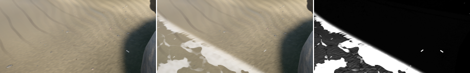 — no event
- 2412 ms [navigate] **pop** 9728 px  — no event
- 2412 ms [navigate] **flash** 7680 px  — no event
- 2679 ms [navigate] **lum** step -1  — no event
- 2679 ms [navigate] **pop** 9728 px  — no event
- 2696 ms [navigate] **pop** 1024 px — no event
- 2879 ms [navigate] **pop** 768 px — no event
- 2879 ms [navigate] **flash** 1024 px — no event
- 3012 ms [navigate] **pop** 1280 px — no event
- 9579 ms [navigate] **flash** 1536 px — lod-pack 86 chunks
- 9645 ms [navigate] **flash** 1024 px — no event
- 9779 ms [navigate] **flash** 1280 px — environment
- 9845 ms [navigate] **flash** 768 px — environment; quality from=5 to=6 cost=9
- 9912 ms [navigate] **pop** 1792 px — environment; quality from=5 to=6 cost=9; lod-pack 89 chunks
- 9912 ms [navigate] **flash** 1024 px — environment; quality from=5 to=6 cost=9; lod-pack 89 chunks
- 9979 ms [navigate] **flash** 1024 px — quality from=5 to=6 cost=9; lod-pack 171 chunks
- 10845 ms [gift fireflies] **flash** 768 px — environment; quality from=6 to=7 cost=35
- 10945 ms [gift fireflies] **sharp** step 10.8 — environment; quality from=6 to=7 cost=35
- 10945 ms [gift fireflies] **flash** 1280 px — environment; quality from=6 to=7 cost=35
- 11012 ms [gift fireflies] **flash** 1536 px — quality from=6 to=7 cost=35
- 11079 ms [gift fireflies] **flash** 768 px — no event
- 11145 ms [gift fireflies] **flash** 1280 px — no event
- 11779 ms [gift fireflies] **pop** 768 px — no event
- 16745 ms [gift fireflies] **pop** 1024 px — no event
- 16778 ms [gift fireflies] **flash** 1792 px — no event
- 16845 ms [gift fireflies] **pop** 768 px — no event
- 16845 ms [gift fireflies] **flash** 3584 px  — no event
- (17 pops while the camera moved; in stability.json)
- 486 ms [navigate] **hitch** 309 ms — no event
- 3239 ms [navigate] **hitch** 175 ms — prewarm-start; magic-pipelines
- 3450 ms [navigate] **hitch** 161 ms — prewarm-end

## throttle

- 529 ms [navigate] **lum** step -2.57 — reveal reveal=0.0625; resize layer=land from=40x25 to=80x50 boundary=false; resize layer=sea from=40x25 to=80x50 boundary=false; resize layer=sky from=40x25 to=80x50 boundary=false; animal-lod herd=herd coarse=true distance=29
- 529 ms [navigate] **sharp** step 17.3 — reveal reveal=0.0625; resize layer=land from=40x25 to=80x50 boundary=false; resize layer=sea from=40x25 to=80x50 boundary=false; resize layer=sky from=40x25 to=80x50 boundary=false; animal-lod herd=herd coarse=true distance=29
- 746 ms [navigate] **lum** step -7.43 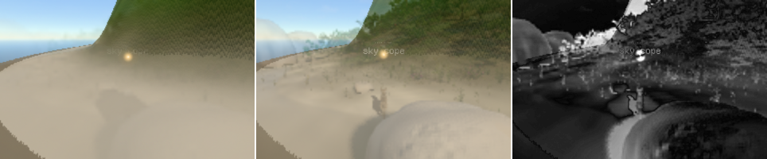 — animal-lod herd=herd coarse=true distance=61; reveal reveal=0.125; resize layer=land from=80x50 to=160x100 boundary=false; resize layer=sea from=80x50 to=160x100 boundary=false; resize layer=sky from=80x50 to=160x100 boundary=false
- 746 ms [navigate] **sharp** step 31.6 — animal-lod herd=herd coarse=true distance=61; reveal reveal=0.125; resize layer=land from=80x50 to=160x100 boundary=false; resize layer=sea from=80x50 to=160x100 boundary=false; resize layer=sky from=80x50 to=160x100 boundary=false
- 746 ms [navigate] **vanish** 1792 px 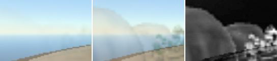 — animal-lod herd=herd coarse=true distance=61; reveal reveal=0.125; resize layer=land from=80x50 to=160x100 boundary=false; resize layer=sea from=80x50 to=160x100 boundary=false; resize layer=sky from=80x50 to=160x100 boundary=false
- 862 ms [navigate] **lum** step -5.31  — animal-lod herd=herd coarse=true distance=61; reveal reveal=0.125; resize layer=land from=80x50 to=160x100 boundary=false; resize layer=sea from=80x50 to=160x100 boundary=false; resize layer=sky from=80x50 to=160x100 boundary=false
- 862 ms [navigate] **sharp** step 7.9 — animal-lod herd=herd coarse=true distance=61; reveal reveal=0.125; resize layer=land from=80x50 to=160x100 boundary=false; resize layer=sea from=80x50 to=160x100 boundary=false; resize layer=sky from=80x50 to=160x100 boundary=false
- 996 ms [navigate] **lum** step -5.06  — reveal reveal=0.25; resize layer=land from=160x100 to=320x200 boundary=false; resize layer=sea from=160x100 to=320x200 boundary=false; resize layer=sky from=160x100 to=320x200 boundary=false
- 996 ms [navigate] **sharp** step 37.4  — reveal reveal=0.25; resize layer=land from=160x100 to=320x200 boundary=false; resize layer=sea from=160x100 to=320x200 boundary=false; resize layer=sky from=160x100 to=320x200 boundary=false
- 996 ms [navigate] **pop** 1792 px — reveal reveal=0.25; resize layer=land from=160x100 to=320x200 boundary=false; resize layer=sea from=160x100 to=320x200 boundary=false; resize layer=sky from=160x100 to=320x200 boundary=false
- 1162 ms [navigate] **lum** step -4.22 — reveal reveal=0.25; resize layer=land from=160x100 to=320x200 boundary=false; resize layer=sea from=160x100 to=320x200 boundary=false; resize layer=sky from=160x100 to=320x200 boundary=false; reveal reveal=0.5; resize layer=land from=320x200 to=640x400 boundary=false; resize layer=sea from=320x200 to=640x400 boundary=false; resize layer=sky from=320x200 to=640x400 boundary=false
- 1162 ms [navigate] **sharp** step 11.6 — reveal reveal=0.25; resize layer=land from=160x100 to=320x200 boundary=false; resize layer=sea from=160x100 to=320x200 boundary=false; resize layer=sky from=160x100 to=320x200 boundary=false; reveal reveal=0.5; resize layer=land from=320x200 to=640x400 boundary=false; resize layer=sea from=320x200 to=640x400 boundary=false; resize layer=sky from=320x200 to=640x400 boundary=false
- 1412 ms [navigate] **lum** step -3.85 — reveal reveal=0.5; resize layer=land from=320x200 to=640x400 boundary=false; resize layer=sea from=320x200 to=640x400 boundary=false; resize layer=sky from=320x200 to=640x400 boundary=false
- 1412 ms [navigate] **sharp** step 90.5  — reveal reveal=0.5; resize layer=land from=320x200 to=640x400 boundary=false; resize layer=sea from=320x200 to=640x400 boundary=false; resize layer=sky from=320x200 to=640x400 boundary=false
- 1412 ms [navigate] **pop** 1024 px — reveal reveal=0.5; resize layer=land from=320x200 to=640x400 boundary=false; resize layer=sea from=320x200 to=640x400 boundary=false; resize layer=sky from=320x200 to=640x400 boundary=false
- 1646 ms [navigate] **lum** step -2 — reveal reveal=1; resize layer=land from=640x400 to=1280x800 boundary=false; resize layer=sea from=640x400 to=1280x800 boundary=false; resize layer=sky from=640x400 to=849x530 boundary=false
- 1646 ms [navigate] **sharp** step 257 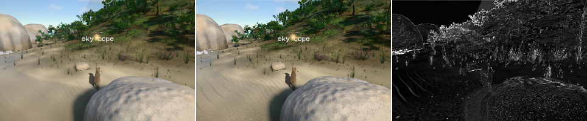 — reveal reveal=1; resize layer=land from=640x400 to=1280x800 boundary=false; resize layer=sea from=640x400 to=1280x800 boundary=false; resize layer=sky from=640x400 to=849x530 boundary=false
- 1646 ms [navigate] **pop** 768 px — reveal reveal=1; resize layer=land from=640x400 to=1280x800 boundary=false; resize layer=sea from=640x400 to=1280x800 boundary=false; resize layer=sky from=640x400 to=849x530 boundary=false
- 1846 ms [navigate] **lum** step -0.81 — no event
- 1846 ms [navigate] **pop** 768 px — no event
- 2096 ms [navigate] **pop** 8192 px  — no event
- 2096 ms [navigate] **flash** 14080 px 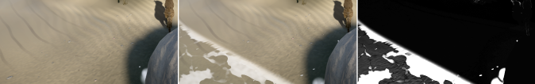 — no event
- 2262 ms [navigate] **lum** step -0.94 — no event
- 2262 ms [navigate] **pop** 11520 px 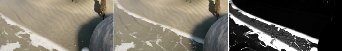 — no event
- 2262 ms [navigate] **flash** 6400 px  — no event
- 2446 ms [navigate] **pop** 4608 px  — no event
- 2446 ms [navigate] **flash** 3840 px — no event
- 2796 ms [navigate] **pop** 768 px — no event
- 2796 ms [navigate] **flash** 1792 px — no event
- 2979 ms [navigate] **pop** 768 px — environment
- 8595 ms [navigate] **flash** 768 px — no event
- 8895 ms [navigate] **pop** 768 px — no event
- 9362 ms [navigate] **pop** 768 px — no event
- 9462 ms [navigate] **flash** 1024 px — no event
- 9662 ms [navigate] **flash** 2304 px — no event
- 10029 ms [navigate] **flash** 768 px — no event
- 10095 ms [navigate] **pop** 1280 px — quality from=3 to=4 cost=37; resize layer=sea from=1050x656 to=870x544 boundary=true
- 10095 ms [navigate] **flash** 768 px — quality from=3 to=4 cost=37; resize layer=sea from=1050x656 to=870x544 boundary=true
- 10529 ms [throttle 4x] **pop** 1024 px — quality from=3 to=4 cost=37; resize layer=sea from=1050x656 to=870x544 boundary=true
- 10679 ms [throttle 4x] **flash** 768 px — no event
- (59 pops while the camera moved; in stability.json)
- 466 ms [navigate] **hitch** 149 ms — no event
- 3648 ms [navigate] **hitch** 118 ms — prewarm-start; magic-pipelines
- 3807 ms [navigate] **hitch** 155 ms — prewarm-end
- 10517 ms [throttle 4x] **hitch** 145 ms — no event

## routes

- 562 ms [navigate] **lum** step -1.61 — no event
- 562 ms [navigate] **sharp** step 5.4 — no event
- 845 ms [navigate] **lum** step -12.19 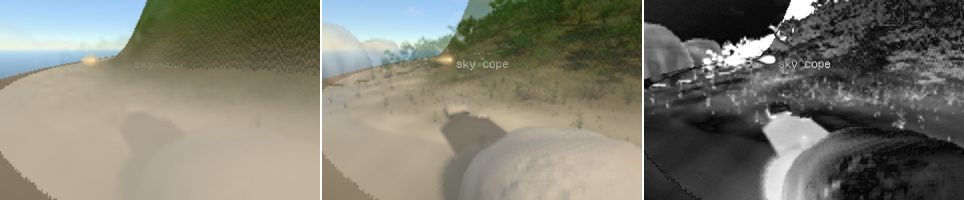 — animal-lod herd=herd coarse=true distance=29; reveal reveal=0.125; resize layer=land from=80x50 to=160x100 boundary=false; resize layer=sea from=80x50 to=160x100 boundary=false; resize layer=sky from=80x50 to=160x100 boundary=false
- 845 ms [navigate] **sharp** step 32 — animal-lod herd=herd coarse=true distance=29; reveal reveal=0.125; resize layer=land from=80x50 to=160x100 boundary=false; resize layer=sea from=80x50 to=160x100 boundary=false; resize layer=sky from=80x50 to=160x100 boundary=false
- 845 ms [navigate] **vanish** 6912 px 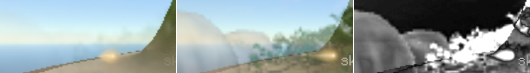 — animal-lod herd=herd coarse=true distance=29; reveal reveal=0.125; resize layer=land from=80x50 to=160x100 boundary=false; resize layer=sea from=80x50 to=160x100 boundary=false; resize layer=sky from=80x50 to=160x100 boundary=false
- 912 ms [navigate] **lum** step -2.94 — animal-lod herd=herd coarse=true distance=29; reveal reveal=0.125; resize layer=land from=80x50 to=160x100 boundary=false; resize layer=sea from=80x50 to=160x100 boundary=false; resize layer=sky from=80x50 to=160x100 boundary=false
- 912 ms [navigate] **sharp** step 5.4 — animal-lod herd=herd coarse=true distance=29; reveal reveal=0.125; resize layer=land from=80x50 to=160x100 boundary=false; resize layer=sea from=80x50 to=160x100 boundary=false; resize layer=sky from=80x50 to=160x100 boundary=false
- 912 ms [navigate] **pop** 1280 px — animal-lod herd=herd coarse=true distance=29; reveal reveal=0.125; resize layer=land from=80x50 to=160x100 boundary=false; resize layer=sea from=80x50 to=160x100 boundary=false; resize layer=sky from=80x50 to=160x100 boundary=false
- 1012 ms [navigate] **lum** step -3.66  — animal-lod herd=herd coarse=true distance=61; reveal reveal=0.25; resize layer=land from=160x100 to=320x200 boundary=false; resize layer=sea from=160x100 to=320x200 boundary=false; resize layer=sky from=160x100 to=320x200 boundary=false
- 1012 ms [navigate] **sharp** step 4.5 — animal-lod herd=herd coarse=true distance=61; reveal reveal=0.25; resize layer=land from=160x100 to=320x200 boundary=false; resize layer=sea from=160x100 to=320x200 boundary=false; resize layer=sky from=160x100 to=320x200 boundary=false
- 1112 ms [navigate] **lum** step -3.22  — animal-lod herd=herd coarse=true distance=61; reveal reveal=0.25; resize layer=land from=160x100 to=320x200 boundary=false; resize layer=sea from=160x100 to=320x200 boundary=false; resize layer=sky from=160x100 to=320x200 boundary=false
- 1112 ms [navigate] **sharp** step 33.2 — animal-lod herd=herd coarse=true distance=61; reveal reveal=0.25; resize layer=land from=160x100 to=320x200 boundary=false; resize layer=sea from=160x100 to=320x200 boundary=false; resize layer=sky from=160x100 to=320x200 boundary=false
- 1112 ms [navigate] **pop** 4608 px — animal-lod herd=herd coarse=true distance=61; reveal reveal=0.25; resize layer=land from=160x100 to=320x200 boundary=false; resize layer=sea from=160x100 to=320x200 boundary=false; resize layer=sky from=160x100 to=320x200 boundary=false
- 1228 ms [navigate] **sharp** step 7.3 — reveal reveal=0.25; resize layer=land from=160x100 to=320x200 boundary=false; resize layer=sea from=160x100 to=320x200 boundary=false; resize layer=sky from=160x100 to=320x200 boundary=false
- 1228 ms [navigate] **pop** 20224 px — reveal reveal=0.25; resize layer=land from=160x100 to=320x200 boundary=false; resize layer=sea from=160x100 to=320x200 boundary=false; resize layer=sky from=160x100 to=320x200 boundary=false
- 1228 ms [navigate] **vanish** 768 px  — reveal reveal=0.25; resize layer=land from=160x100 to=320x200 boundary=false; resize layer=sea from=160x100 to=320x200 boundary=false; resize layer=sky from=160x100 to=320x200 boundary=false
- 1378 ms [navigate] **lum** step -1.81 — reveal reveal=0.5; resize layer=land from=320x200 to=640x400 boundary=false; resize layer=sea from=320x200 to=640x400 boundary=false; resize layer=sky from=320x200 to=640x400 boundary=false
- 1378 ms [navigate] **sharp** step 81.5  — reveal reveal=0.5; resize layer=land from=320x200 to=640x400 boundary=false; resize layer=sea from=320x200 to=640x400 boundary=false; resize layer=sky from=320x200 to=640x400 boundary=false
- 1378 ms [navigate] **pop** 768 px — reveal reveal=0.5; resize layer=land from=320x200 to=640x400 boundary=false; resize layer=sea from=320x200 to=640x400 boundary=false; resize layer=sky from=320x200 to=640x400 boundary=false
- 1495 ms [navigate] **lum** step -1.11 — reveal reveal=0.5; resize layer=land from=320x200 to=640x400 boundary=false; resize layer=sea from=320x200 to=640x400 boundary=false; resize layer=sky from=320x200 to=640x400 boundary=false
- 1678 ms [navigate] **lum** step -1.1 — reveal reveal=1; resize layer=land from=640x400 to=1280x800 boundary=false; resize layer=sea from=640x400 to=1280x800 boundary=false; resize layer=sky from=640x400 to=849x530 boundary=false
- 1678 ms [navigate] **sharp** step 247.8 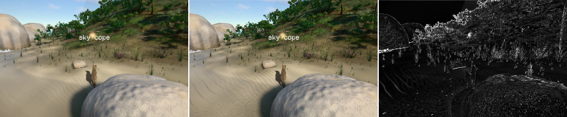 — reveal reveal=1; resize layer=land from=640x400 to=1280x800 boundary=false; resize layer=sea from=640x400 to=1280x800 boundary=false; resize layer=sky from=640x400 to=849x530 boundary=false
- 2012 ms [navigate] **pop** 768 px — no event
- 2195 ms [navigate] **pop** 5632 px — no event
- 2195 ms [navigate] **flash** 11520 px  — no event
- 2262 ms [navigate] **pop** 11776 px — no event
- 2262 ms [navigate] **flash** 14848 px  — no event
- 2412 ms [navigate] **pop** 1536 px — no event
- 2428 ms [navigate] **pop** 4608 px — no event
- 2545 ms [navigate] **flash** 1024 px — no event
- 2695 ms [navigate] **pop** 768 px — no event
- 3162 ms [navigate] **pop** 768 px — prewarm-start; magic-pipelines
- 8011 ms [navigate] **vanish** (moving) 4864 px  — shadow-request jump=false; shadow-slice slice=1 count=8; quality from=2 to=3 cost=24; resize layer=sea from=1280x800 to=1050x656 boundary=true; place-lod place=445f1f from=1 to=0 x=-4.456042089753154 z=38.35820823377907; shadow-slice slice=2 count=8; lod-pack 70 chunks
- 8645 ms [navigate] **flash** 4096 px — no event
- 8711 ms [navigate] **flash** 3840 px — no event
- 8778 ms [navigate] **flash** 4352 px — no event
- 8845 ms [navigate] **flash** 2560 px — no event
- 8978 ms [navigate] **flash** 768 px — no event
- 9045 ms [navigate] **flash** 768 px — no event
- 9161 ms [navigate] **pop** 768 px — no event
- (311 pops while the camera moved; in stability.json)
- 467 ms [navigate] **hitch** 232 ms — no event
- 3016 ms [navigate] **hitch** 118 ms — prewarm-start; magic-pipelines
- 3165 ms [navigate] **hitch** 153 ms — prewarm-end
