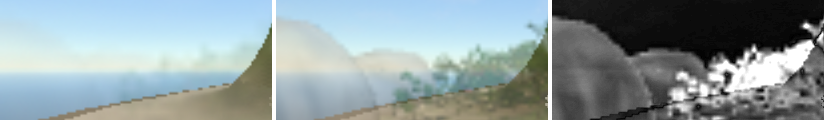
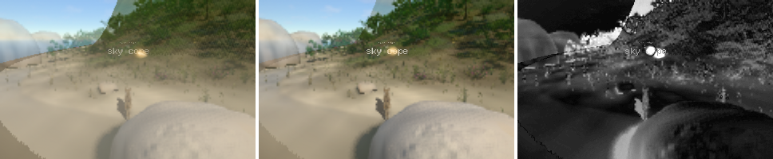
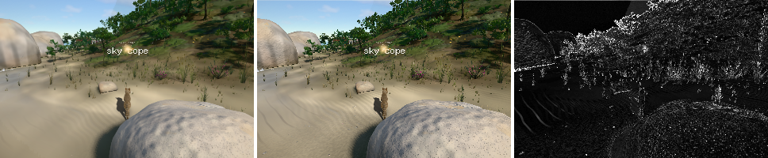

# Stability, 2026-11-15T06:56 (1280x800 @1, seed 1847)

| session | captured | seconds | blank | lum | sharp | popStill | popMoving | worstPopPixels | flashStill | flashMoving | vanishStill | vanishMoving | flicker | leafLight | leafSteps | hitches | worstHitchMs | resizes | unsynced | quality | reveal | shadowSwaps | placeLod | animalLod | errors |
| --- | --- | --- | --- | --- | --- | --- | --- | --- | --- | --- | --- | --- | --- | --- | --- | --- | --- | --- | --- | --- | --- | --- | --- | --- | --- |
| routes | 428 | 80 | 0 | 6 | 4 | 34 | 204 | 18944 | 21 | 155 | 6 | 154 | 0.956 | 0.478 | 7 | 4 | 471 | 20 | 15 | 10 | 5 | 25 | 14 | 5 | 0 |

Columns: frames captured (screencast) and seconds rendered; blank frames; persistent luminance
and sharpness steps with the camera still; pops (abrupt local changes that stay) with the camera
still and moving, the worst still one in pixels; one-frame flashes; hitches (gaps of 100 ms+
between rendered frames) and the worst; canvas resizes and those outside the frame boundary;
budget level changes; reveal steps; shadow-map swaps; landmark and animal LOD switches.

## routes

- 840 ms [navigate] **flash** 768 px — reveal reveal=0.125; resize layer=land from=80x50 to=160x100 boundary=false; resize layer=sea from=80x50 to=160x100 boundary=false; resize layer=sky from=80x50 to=160x100 boundary=false
- 840 ms [navigate] **vanish** 5120 px  — reveal reveal=0.125; resize layer=land from=80x50 to=160x100 boundary=false; resize layer=sea from=80x50 to=160x100 boundary=false; resize layer=sky from=80x50 to=160x100 boundary=false
- 1073 ms [navigate] **lum** step -8.75  — reveal reveal=0.125; resize layer=land from=80x50 to=160x100 boundary=false; resize layer=sea from=80x50 to=160x100 boundary=false; resize layer=sky from=80x50 to=160x100 boundary=false; reveal reveal=0.25; resize layer=land from=160x100 to=320x200 boundary=false; resize layer=sea from=160x100 to=320x200 boundary=false; resize layer=sky from=160x100 to=320x200 boundary=false
- 1073 ms [navigate] **sharp** step 16.1 — reveal reveal=0.125; resize layer=land from=80x50 to=160x100 boundary=false; resize layer=sea from=80x50 to=160x100 boundary=false; resize layer=sky from=80x50 to=160x100 boundary=false; reveal reveal=0.25; resize layer=land from=160x100 to=320x200 boundary=false; resize layer=sea from=160x100 to=320x200 boundary=false; resize layer=sky from=160x100 to=320x200 boundary=false
- 1240 ms [navigate] **lum** step -4.13 — reveal reveal=0.25; resize layer=land from=160x100 to=320x200 boundary=false; resize layer=sea from=160x100 to=320x200 boundary=false; resize layer=sky from=160x100 to=320x200 boundary=false
- 1240 ms [navigate] **sharp** step 38.1 — reveal reveal=0.25; resize layer=land from=160x100 to=320x200 boundary=false; resize layer=sea from=160x100 to=320x200 boundary=false; resize layer=sky from=160x100 to=320x200 boundary=false
- 1240 ms [navigate] **pop** 3072 px — reveal reveal=0.25; resize layer=land from=160x100 to=320x200 boundary=false; resize layer=sea from=160x100 to=320x200 boundary=false; resize layer=sky from=160x100 to=320x200 boundary=false
- 1506 ms [navigate] **lum** step -3.75 — reveal reveal=0.5; resize layer=land from=320x200 to=640x400 boundary=false; resize layer=sea from=320x200 to=640x400 boundary=false; resize layer=sky from=320x200 to=640x400 boundary=false
- 1506 ms [navigate] **sharp** step 89.9 — reveal reveal=0.5; resize layer=land from=320x200 to=640x400 boundary=false; resize layer=sea from=320x200 to=640x400 boundary=false; resize layer=sky from=320x200 to=640x400 boundary=false
- 1690 ms [navigate] **lum** step -1.55 — reveal reveal=1; resize layer=land from=640x400 to=1280x800 boundary=false; resize layer=sea from=640x400 to=1280x800 boundary=false; resize layer=sky from=640x400 to=849x530 boundary=false
- 1690 ms [navigate] **sharp** step 247.8  — reveal reveal=1; resize layer=land from=640x400 to=1280x800 boundary=false; resize layer=sea from=640x400 to=1280x800 boundary=false; resize layer=sky from=640x400 to=849x530 boundary=false
- 1923 ms [navigate] **lum** step -0.93 — reveal reveal=1; resize layer=land from=640x400 to=1280x800 boundary=false; resize layer=sea from=640x400 to=1280x800 boundary=false; resize layer=sky from=640x400 to=849x530 boundary=false
- 2140 ms [navigate] **pop** 6656 px — no event
- 2140 ms [navigate] **flash** 10752 px — no event
- 2323 ms [navigate] **pop** 18944 px — no event
- 2323 ms [navigate] **flash** 8448 px — no event
- 2590 ms [navigate] **lum** step -1 — no event
- 2590 ms [navigate] **pop** 13056 px — no event
- 2590 ms [navigate] **flash** 2560 px — no event
- 2973 ms [navigate] **pop** 768 px — no event
- 2973 ms [navigate] **flash** 768 px — no event
- 3206 ms [navigate] **pop** 1280 px — no event
- 8839 ms [navigate] **flash** 1536 px — no event
- 8839 ms [navigate] **vanish** 1024 px — no event
- 9006 ms [navigate] **flash** (moving) 1024 px — no event
- 9239 ms [navigate] **vanish** (moving) 3840 px — shadow-request jump=false; environment; shadow-slice slice=1 count=4; place-lod place=41be40 from=1 to=0 x=-4.456042089753154 z=38.35820823377907; lod-pack 70 chunks
- 9706 ms [navigate] **flash** (moving) 768 px — lod-pack 40 chunks
- 9873 ms [navigate] **pop** 768 px — quality from=0 to=1 cost=17
- 9873 ms [navigate] **flash** 1280 px — quality from=0 to=1 cost=17
- 10073 ms [navigate] **pop** 2048 px — quality from=0 to=1 cost=17
- 10073 ms [navigate] **flash** 1024 px — quality from=0 to=1 cost=17
- 10239 ms [navigate] **flash** 3584 px — no event
- 10439 ms [navigate] **pop** 1280 px — no event
- 10439 ms [navigate] **flash** 4608 px — no event
- 10656 ms [navigate] **flash** 3328 px — no event
- 10856 ms [navigate] **pop** 1280 px — quality from=1 to=2 cost=19; resize layer=sky from=849x530 to=636x398 boundary=true
- 10856 ms [navigate] **flash** 2560 px — quality from=1 to=2 cost=19; resize layer=sky from=849x530 to=636x398 boundary=true
- 11056 ms [navigate] **pop** 1024 px — quality from=1 to=2 cost=19; resize layer=sky from=849x530 to=636x398 boundary=true
- 11056 ms [navigate] **flash** 8192 px — quality from=1 to=2 cost=19; resize layer=sky from=849x530 to=636x398 boundary=true
- 11273 ms [navigate] **flash** 6656 px — no event
- (204 pops while the camera moved; in stability.json)
- 546 ms [navigate] **hitch** 223 ms — no event
- 3328 ms [navigate] **hitch** 186 ms — prewarm-start; magic-pipelines
- 12493 ms [foliage-walk] **hitch** 257 ms — no event
- 12793 ms [foliage-walk] **hitch** 471 ms — no event
